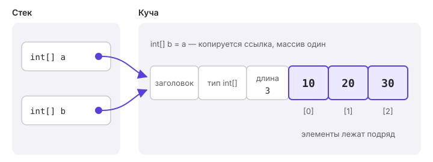

::::warmup

```quiz
id: default-element
type: output
prompt: Что выведет код?
code: |
  int[] numbers = new int[3];
  Console.WriteLine(numbers[1]);
answer: "0"
explain: |
  Новый массив сразу заполнен значениями по умолчанию: у `int` это 0. В отличие от локальной переменной, элемент массива можно читать без присваивания.
variants:
  - code: |
      bool[] flags = new bool[2];
      Console.WriteLine(flags[0]);
    answer: "False"
    explain: |
      Элементы нового массива получают значение по умолчанию своего типа. У `bool` это `false`.
  - code: |
      double[] values = new double[4];
      Console.WriteLine(values.Length);
    answer: "4"
    explain: |
      `Length` — число элементов, а не число заполненных: массив из четырёх нулей имеет длину 4.
```

::::

::::part Создание и доступ

**Массив** — набор элементов одного типа фиксированной длины. Тип массива пишут как тип элемента с квадратными скобками: `int[]`, `string[]`.

```csharp
int[] a = new int[5];        // пять нулей
int[] b = new int[] { 1, 2, 3 };
int[] c = { 1, 2, 3 };       // короче, при объявлении
int[] d = [1, 2, 3];         // выражение коллекции, C# 12
var e = new[] { 1.5, 2.5 };  // тип элементов выводится: double[]
```

**Элементы нумеруются с нуля.** Первый — `a[0]`, последний — `a[a.Length - 1]`. Свойство `Length` — число элементов.

**Длина задаётся при создании и больше не меняется.** Добавить элемент в массив нельзя, можно только создать новый, больший. Для коллекций переменного размера есть `List<T>`, ему посвящена отдельная тема.

**Выход за границы** компилятор не ловит: индекс может быть вычислен во время выполнения. Программа бросает `IndexOutOfRangeException`:

```csharp
int[] a = new int[3];
a[3] = 1;  // исключение: допустимые индексы — 0, 1, 2
```

Новый массив заполнен значениями по умолчанию: `0` у чисел, `false` у `bool`, `null` у строк (пустая ссылка, об этом — в теме про `null`).

**Массив — ссылочный тип.** Переменная хранит не сами элементы, а ссылку на объект массива в куче. Присваивание копирует ссылку: две переменные начинают указывать на один массив.



```csharp
int[] a = { 10, 20, 30 };
int[] b = a;              // b указывает на тот же массив
b[0] = 99;
Console.WriteLine(a[0]);  // 99
```

Подробно о ссылках и копировании — в теме про значимые и ссылочные типы. Пока главное: присваивание массива не создаёт копию.

`Console.WriteLine(a)` выведет не элементы, а имя типа: `System.Int32[]`. Чтобы увидеть содержимое, его склеивают в строку: `string.Join(", ", a)`.

```quiz
id: shared-array
type: output
prompt: Что выведет код?
code: |
  int[] a = { 1, 2, 3 };
  int[] b = a;
  b[0] = 9;
  Console.WriteLine(a[0]);
answer: "9"
explain: |
  `int[] b = a` копирует ссылку, а не массив. `a` и `b` указывают на один объект, поэтому изменение через `b` видно через `a`.
variants:
  - code: |
      int[] a = { 1, 2, 3 };
      int[] b = a;
      a = new int[] { 7, 8, 9 };
      Console.WriteLine(b[0]);
    answer: "1"
    explain: |
      `a = new int[]...` записывает в `a` ссылку на новый массив. `b` по-прежнему указывает на старый, где первый элемент — 1.
  - code: |
      int[] a = { 1, 2, 3 };
      Change(a);
      Console.WriteLine(a[1]);

      void Change(int[] items) => items[1] = 50;
    answer: "50"
    explain: |
      Метод получил копию ссылки, но она указывает на тот же массив. Изменение элемента видно снаружи.
```

```quiz
id: out-of-range
type: find-bug
prompt: В какой строке программа упадёт?
code: |
  int[] scores = { 5, 4, 3 };
  int sum = 0;
  for (int i = 0; i <= scores.Length; i++)
      sum += scores[i];
  Console.WriteLine(sum);
answer: 4
explain: |
  Условие `i <= scores.Length` пропускает `i = 3`, а последний индекс — 2. На чтении `scores[3]` программа бросит `IndexOutOfRangeException`. Нужно `i < scores.Length`.
```

::::

::::part Индексы с конца и диапазоны

**Индекс с конца** пишут через `^`: `a[^1]` — последний элемент, `a[^2]` — предпоследний. `^1` означает «длина минус 1», поэтому `a[^0]` — уже за границей.

```csharp
int[] a = { 10, 20, 30, 40, 50 };

Console.WriteLine(a[^1]);  // 50
Console.WriteLine(a[^2]);  // 40
```

**Диапазон** `a[start..end]` возвращает часть массива: от `start` включительно до `end` **не включительно**. Любую границу можно опустить:

```csharp
int[] middle = a[1..4];  // { 20, 30, 40 }
int[] first = a[..2];    // { 10, 20 }
int[] rest = a[2..];     // { 30, 40, 50 }
int[] tail = a[^2..];    // { 40, 50 }
```

Диапазон массива — это **новый** массив с копией элементов. Изменение `middle` не затронет `a`.

```quiz
id: from-end
type: output
prompt: Что выведет код?
code: |
  int[] a = { 10, 20, 30, 40 };
  Console.WriteLine(a[^1]);
answer: "40"
explain: |
  `^1` — первый элемент с конца, то есть последний.
variants:
  - code: |
      int[] a = { 10, 20, 30, 40 };
      Console.WriteLine(a[^3]);
    answer: "20"
    explain: |
      `^3` — третий с конца: длина 4 минус 3, это индекс 1.
  - code: |
      int[] a = { 10, 20, 30, 40, 50 };
      Console.WriteLine(a[1..3].Length);
    answer: "2"
    explain: |
      Диапазон `1..3` берёт индексы 1 и 2: конец не включается. В новом массиве два элемента.
```

::::

::::part Многомерные и зубчатые массивы

**Многомерный (прямоугольный) массив** — таблица, где у всех строк одинаковая длина. Индексы перечисляют через запятую:

```csharp
int[,] grid = new int[3, 4];  // 3 строки по 4 столбца
grid[1, 2] = 7;

Console.WriteLine(grid.Length);        // 12: всего элементов
Console.WriteLine(grid.GetLength(0));  // 3: строк
Console.WriteLine(grid.GetLength(1));  // 4: столбцов
```

**Зубчатый массив** (jagged) — массив массивов. Каждая строка — отдельный массив своей длины:

```csharp
int[][] rows = new int[3][];  // три строки, пока пустые (null)
rows[0] = new int[2];
rows[1] = new int[5];
rows[2] = [1, 2, 3];

Console.WriteLine(rows[1].Length);  // 5
Console.WriteLine(rows[2][0]);      // 1: строка 2, элемент 0
```

| | `int[,]` | `int[][]` |
|---|---|---|
| Форма | прямоугольник | строки разной длины |
| В памяти | один объект, все элементы подряд | внешний массив ссылок и отдельный массив на каждую строку |
| Доступ | `grid[i, j]` | `rows[i][j]` |
| `Length` | все элементы | число строк |

```quiz
id: array-length-2d
type: output
prompt: Что выведет код?
code: |
  int[,] grid = new int[3, 5];
  Console.WriteLine(grid.Length);
answer: "15"
explain: |
  У многомерного массива `Length` — общее число элементов: 3 × 5 = 15. Размеры по измерениям даёт `GetLength`.
variants:
  - code: |
      int[,] grid = new int[3, 5];
      Console.WriteLine(grid.GetLength(1));
    answer: "5"
    explain: |
      `GetLength(1)` — размер второго измерения, то есть число столбцов.
  - code: |
      int[][] rows = new int[3][];
      Console.WriteLine(rows.Length);
    answer: "3"
    explain: |
      У зубчатого массива `Length` — число строк, то есть длина внешнего массива. Сами строки пока не созданы.
```

```quiz
id: jagged-choice
type: choice
prompt: |
  Нужно хранить расписание: в каждый день недели разное количество занятий. Какой массив подходит?
options:
  - "Зубчатый int[][]: у каждой строки своя длина"
  - "Многомерный int[,]: у всех строк одна длина"
  - "Одномерный int[] длиной 7"
  - "Никакой: массивы не умеют хранить таблицы"
answer: 0
explain: |
  В прямоугольном массиве все строки одной длины, пришлось бы заводить строку по самому загруженному дню. Зубчатый массив хранит каждый день отдельным массивом нужной длины.
```

::::

::::part Класс Array и полезные методы

У всех массивов есть общие методы из класса `Array`:

| Метод | Что делает |
|---|---|
| `Array.Sort(a)` | сортирует массив на месте |
| `Array.Reverse(a)` | переворачивает на месте |
| `Array.IndexOf(a, value)` | индекс первого вхождения или **-1**, если нет |
| `Array.Fill(a, value)` | заполняет все элементы значением |
| `Array.Copy(from, to, count)` | копирует элементы в другой массив |
| `Array.Resize(ref a, size)` | создаёт новый массив нужного размера и копирует элементы |
| `Array.Empty<int>()` | пустой массив без нового выделения памяти |

`Array.Resize` не растягивает массив: длина массива не меняется никогда. Метод создаёт новый массив, копирует элементы и записывает ссылку в переменную. Поэтому параметр передаётся через `ref`.

**Сравнение массивов.** `a == b` сравнивает ссылки, а не содержимое: два разных массива с одинаковыми элементами не равны. Содержимое сравнивают поэлементно, например методом `a.SequenceEqual(b)` из LINQ.

```csharp
int[] x = { 1, 2 };
int[] y = { 1, 2 };
Console.WriteLine(x == y);  // False: разные объекты
```

```quiz
id: index-of
type: output
prompt: Что выведет код?
code: |
  int[] a = { 4, 8, 15, 16 };
  Console.WriteLine(Array.IndexOf(a, 23));
answer: "-1"
explain: |
  Значения 23 в массиве нет. `IndexOf` в этом случае возвращает -1, исключение не бросается.
variants:
  - code: |
      int[] a = { 4, 8, 15, 8 };
      Console.WriteLine(Array.IndexOf(a, 8));
    answer: "1"
    explain: |
      `IndexOf` возвращает индекс первого вхождения: 8 встречается на позициях 1 и 3.
  - code: |
      int[] a = { 3, 1, 2 };
      Array.Sort(a);
      Console.WriteLine(a[0]);
    answer: "1"
    explain: |
      `Array.Sort` сортирует сам массив, на месте. После сортировки первым стоит наименьший элемент.
```

```quiz
id: arrays-equal
type: output
prompt: Что выведет код?
code: |
  int[] x = { 1, 2, 3 };
  int[] y = { 1, 2, 3 };
  Console.WriteLine(x == y);
answer: "False"
explain: |
  `==` для массивов сравнивает ссылки. `x` и `y` — два разных объекта с одинаковым содержимым.
```

:::level middle

**Массив в памяти.** Объект массива — заголовок, указатель на тип, длина и элементы подряд. Для `int[1000]` это примерно 4 КБ данных и 24 байта служебной части. Элементы значимых типов лежат прямо в массиве, а у `string[]` в массиве лежат ссылки, сами строки — отдельными объектами.

Массивы больше 85 000 байт попадают в особую область — кучу больших объектов (LOH), где сборка мусора дороже. Об этом — в разделе «Память».

**Зубчатый быстрее многомерного.** Доступ к `int[,]` вычисляет смещение по формуле, и JIT хуже оптимизирует такие циклы. Одномерные массивы, из которых состоит `int[][]`, оптимизируются лучше, поэтому в критичном к скорости коде зубчатые массивы встречаются чаще.

:::

::::

::::practice

```quiz
id: max-task
type: code
lang: csharp
prompt: |
  Допишите метод: он возвращает наибольший элемент непустого массива.
starter: |
  public static class Arrays
  {
      public static int Max(int[] numbers)
      {
      }
  }
tests: |
  Assert.Equal(9, Arrays.Max(new[] { 3, 9, 2 }));
  Assert.Equal(-1, Arrays.Max(new[] { -5, -1, -7 }));
  Assert.Equal(42, Arrays.Max(new[] { 42 }));
solution: |
  public static class Arrays
  {
      public static int Max(int[] numbers)
      {
          int max = numbers[0];
          foreach (int n in numbers)
          {
              if (n > max)
                  max = n;
          }
          return max;
      }
  }
explain: |
  Начальным максимумом берут первый элемент, а не 0: иначе для массива из одних отрицательных чисел ответ был бы неверным.
variants:
  - prompt: |
      Допишите метод: он возвращает, сколько элементов массива больше заданного порога.
    starter: |
      public static class Arrays
      {
          public static int CountAbove(int[] numbers, int limit)
          {
          }
      }
    tests: |
      Assert.Equal(2, Arrays.CountAbove(new[] { 1, 5, 7, 3 }, 4));
      Assert.Equal(0, Arrays.CountAbove(new int[0], 10));
      Assert.Equal(0, Arrays.CountAbove(new[] { 4, 4 }, 4));
    solution: |
      public static class Arrays
      {
          public static int CountAbove(int[] numbers, int limit)
          {
              int count = 0;
              foreach (int n in numbers)
              {
                  if (n > limit)
                      count++;
              }
              return count;
          }
      }
    explain: |
      `foreach` проходит по всем элементам, счётчик растёт для подходящих. Пустой массив цикл не выполняет, и ответ — 0.
  - prompt: |
      Допишите метод: он переворачивает массив на месте, не создавая нового. Метод ничего не возвращает, но вызывающий код должен увидеть изменения.
    starter: |
      public static class Arrays
      {
          public static void ReverseInPlace(int[] numbers)
          {
          }
      }
    tests: |
      var a = new[] { 1, 2, 3, 4 };
      Arrays.ReverseInPlace(a);
      Assert.Equal(4, a[0]);
      Assert.Equal(1, a[3]);
      var b = new[] { 1, 2, 3 };
      Arrays.ReverseInPlace(b);
      Assert.Equal(3, b[0]);
      Assert.Equal(2, b[1]);
    solution: |
      public static class Arrays
      {
          public static void ReverseInPlace(int[] numbers)
          {
              for (int i = 0, j = numbers.Length - 1; i < j; i++, j--)
              {
                  int temp = numbers[i];
                  numbers[i] = numbers[j];
                  numbers[j] = temp;
              }
          }
      }
    explain: |
      Два индекса идут навстречу и меняют элементы местами. Метод получил копию ссылки, но она указывает на тот же массив, поэтому изменения видны снаружи без `ref`.
```

```quiz
id: range-fill
type: fill
prompt: Вставьте диапазон, чтобы получить последние три элемента массива любой длины.
code: |
  int[] last = numbers[___];
answer: "^3.."
explain: |
  `^3` — третий элемент с конца, а пустая правая граница — до конца массива.
```

::::

::::traps

- **Индексы — с нуля, последний — `Length - 1`.** Цикл `i <= a.Length` выходит за границу.
- **Длина массива не меняется.** `Array.Resize` создаёт новый массив.
- **Присваивание массива копирует ссылку**, а не элементы.
- **`a == b` сравнивает ссылки.** Содержимое — поэлементно.
- **`a[^0]` — уже за границей:** последний элемент — `a[^1]`.
- **Диапазон не включает правую границу** и создаёт новый массив.
- **`Length` у `int[,]` — все элементы, у `int[][]` — число строк.**

::::

::::summary

```quiz
id: arrays-recall
type: recall
prompt: Расскажите, как устроен массив в C# и какие у него ловушки.
answer: |
  Массив — набор элементов одного типа фиксированной длины, индексы с нуля. Новый массив заполнен значениями по умолчанию. Выход за границы бросает `IndexOutOfRangeException` во время выполнения.
  Массив — **ссылочный тип**: переменная хранит ссылку на объект в куче, присваивание и передача в метод копируют ссылку, а не элементы. `==` сравнивает ссылки.
  `a[^1]` — последний элемент, `a[1..3]` — новый массив из элементов с индексами 1 и 2.
  Многомерный `int[,]` — прямоугольник одним объектом, зубчатый `int[][]` — массив массивов разной длины.
  Длину изменить нельзя: `Array.Resize` создаёт новый массив. Для коллекций переменного размера берут `List<T>`.
```

::::

::::test

```quiz
id: test-print-array
type: output
part: "Создание и доступ"
prompt: Что выведет код?
code: |
  int[] a = { 1, 2, 3 };
  Console.WriteLine(a);
answer: System.Int32[]
explain: |
  `WriteLine` выводит имя типа массива, а не элементы. Содержимое печатают через `string.Join(", ", a)`.
```

```quiz
id: test-length-fixed
type: choice
part: "Создание и доступ"
prompt: Как добавить элемент в конец массива `int[] a`?
options:
  - "Никак: длина массива не меняется, нужен новый массив или List<int>"
  - "a.Add(5)"
  - "a[a.Length] = 5"
  - "a.Length++"
answer: 0
explain: |
  Длина задаётся при создании. `a[a.Length]` — выход за границу, у массива нет `Add`, а `Length` только для чтения.
```

```quiz
id: test-string-default
type: choice
part: "Создание и доступ"
prompt: Чем заполнен новый массив `new string[3]`?
options:
  - "null: пустыми ссылками"
  - "Пустыми строками \"\""
  - "Пробелами"
  - "Ничем: читать элементы до присваивания нельзя"
answer: 0
explain: |
  Элементы получают значение по умолчанию своего типа. Строка — ссылочный тип, её значение по умолчанию — `null`.
```

```quiz
id: test-array-param
type: output
part: "Создание и доступ"
prompt: Что выведет код?
code: |
  int[] a = { 1, 2, 3 };
  Reset(a);
  Console.WriteLine(a[0]);

  void Reset(int[] items) => items = new int[3];
answer: "1"
explain: |
  Метод записал в свой параметр ссылку на новый массив, но переменная `a` снаружи по-прежнему указывает на старый. Изменился бы элемент, а не параметр, — было бы видно.
variants:
  - code: |
      int[] a = { 1, 2, 3 };
      Reset(a);
      Console.WriteLine(a[0]);

      void Reset(int[] items) => items[0] = 0;
    answer: "0"
    explain: |
      Параметр указывает на тот же массив, что и `a`. Изменение элемента видно снаружи.
```

```quiz
id: test-range
type: output
part: "Индексы с конца и диапазоны"
prompt: Что выведет код? `string.Join(",", x)` склеивает элементы через запятую.
code: |
  int[] a = { 1, 2, 3, 4, 5 };
  Console.WriteLine(string.Join(",", a[1..^1]));
answer: 2,3,4
explain: |
  Диапазон от индекса 1 включительно до `^1` (последнего элемента) не включительно: элементы 2, 3 и 4.
variants:
  - code: |
      int[] a = { 1, 2, 3, 4, 5 };
      Console.WriteLine(string.Join(",", a[..2]));
    answer: 1,2
    explain: |
      Диапазон от начала до индекса 2 не включительно: элементы с индексами 0 и 1.
```

```quiz
id: test-hat-zero
type: choice
part: "Индексы с конца и диапазоны"
prompt: Что произойдёт при обращении `a[^0]`?
options:
  - "Будет брошено IndexOutOfRangeException"
  - "Вернётся первый элемент"
  - "Вернётся последний элемент"
  - "Ошибка компиляции"
answer: 0
explain: |
  `^0` означает индекс, равный длине массива, — сразу за последним элементом. Последний элемент — `^1`.
```

```quiz
id: test-range-copy
type: output
part: "Индексы с конца и диапазоны"
prompt: Что выведет код?
code: |
  int[] a = { 1, 2, 3 };
  int[] part = a[0..2];
  part[0] = 100;
  Console.WriteLine(a[0]);
answer: "1"
explain: |
  Диапазон массива создаёт новый массив с копией элементов. Изменение `part` не трогает `a`.
```

```quiz
id: test-jagged-access
type: output
part: "Многомерные и зубчатые массивы"
prompt: Что выведет код?
code: |
  int[][] rows = { new[] { 1, 2 }, new[] { 3, 4, 5 } };
  Console.WriteLine(rows[1][2]);
answer: "5"
explain: |
  `rows[1]` — вторая строка `{ 3, 4, 5 }`, а `[2]` — её третий элемент.
variants:
  - code: |
      int[][] rows = { new[] { 1, 2 }, new[] { 3, 4, 5 } };
      Console.WriteLine(rows[0].Length + rows[1].Length);
    answer: "5"
    explain: |
      У строк зубчатого массива своя длина: 2 и 3, вместе 5.
```

```quiz
id: test-rect-index
type: fill
part: "Многомерные и зубчатые массивы"
prompt: Вставьте обращение к элементу в строке 1, столбце 2 многомерного массива.
code: |
  int[,] grid = new int[3, 4];
  grid___ = 7;
answer: ["[1, 2]", "[1,2]"]
explain: |
  У многомерного массива индексы перечисляют через запятую в одних скобках: `grid[1, 2]`. Запись `[1][2]` — для зубчатого.
```

```quiz
id: test-resize
type: choice
part: "Класс Array и полезные методы"
prompt: Что делает `Array.Resize(ref a, 10)`?
options:
  - "Создаёт новый массив длины 10, копирует элементы и записывает ссылку в a"
  - "Увеличивает длину существующего массива"
  - "Удаляет все элементы после десятого"
  - "Заполняет массив десятками"
answer: 0
explain: |
  Длина массива не меняется никогда. `Resize` создаёт новый массив, поэтому и принимает `ref`: ему нужно заменить ссылку в переменной.
```

```quiz
id: test-reverse
type: output
part: "Класс Array и полезные методы"
prompt: Что выведет код?
code: |
  int[] a = { 1, 2, 3 };
  Array.Reverse(a);
  Console.WriteLine(a[0]);
answer: "3"
explain: |
  `Array.Reverse` переворачивает сам массив, на месте. Первым становится бывший последний элемент.
```

```quiz
id: test-index-of-missing
type: choice
part: "Класс Array и полезные методы"
prompt: Что вернёт `Array.IndexOf(a, x)`, если значения `x` в массиве нет?
options:
  - "-1"
  - "0"
  - "a.Length"
  - "Бросит исключение"
answer: 0
explain: |
  -1 — признак «не найдено»: корректного индекса с таким значением не бывает.
```

```quiz
id: test-loh
type: choice
part: "Класс Array и полезные методы"
level: middle
prompt: Куда попадает массив `new int[100_000]`?
options:
  - "В кучу больших объектов (LOH): он больше 85 000 байт"
  - "В стек: элементы — значимые типы"
  - "В обычную кучу, как любой объект"
  - "В статическую память программы"
answer: 0
explain: |
  100 000 × 4 байта = 400 000 байт, это больше порога в 85 000 байт. Такие объекты .NET размещает в LOH, сборка мусора там дороже.
```

::::
