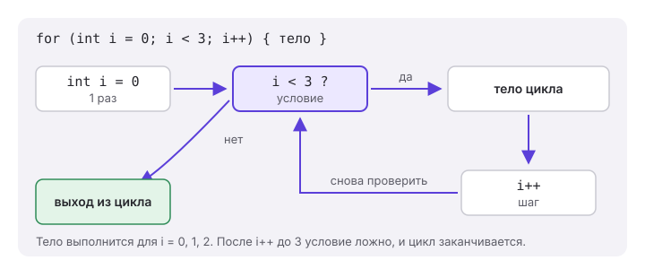

::::warmup

```quiz
id: for-step
type: output
prompt: Что выведет код? `Console.Write` печатает без перевода строки.
code: |
  for (int i = 0; i < 10; i += 3)
      Console.Write(i);
answer: "0369"
explain: |
  `i` начинается с 0 и растёт на 3: 0, 3, 6, 9. Следующее значение, 12, уже не проходит условие `i < 10`, и цикл заканчивается.
variants:
  - code: |
      for (int i = 5; i > 0; i -= 2)
          Console.Write(i);
    answer: "531"
    explain: |
      `i` начинается с 5 и уменьшается на 2: 5, 3, 1. Следующее значение, -1, не проходит условие `i > 0`.
  - code: |
      for (int i = 1; i <= 16; i *= 2)
          Console.Write(i);
    answer: "124816"
    explain: |
      Шаг цикла может быть любым выражением, здесь — умножение на 2: 1, 2, 4, 8, 16. Следующее, 32, больше 16.
```

::::

::::part if и else

`if` выполняет блок, если условие истинно. `else` — если ложно. Цепочка `else if` проверяет условия по очереди до первого истинного:

```csharp
int score = 72;

if (score >= 90)
{
    Console.WriteLine("отлично");
}
else if (score >= 60)
{
    Console.WriteLine("зачёт");  // выполнится эта ветка
}
else
{
    Console.WriteLine("незачёт");
}
```

Условие обязано иметь тип `bool`. В C и JavaScript `if (count)` проверяет число на ноль, а в C# это ошибка компиляции. Отсюда приятное следствие: опечатка `if (x = 5)` вместо `if (x == 5)` не скомпилируется, ведь результат присваивания `x = 5` — `int`.

Фигурные скобки можно опустить, если в ветке один оператор. Но тогда легко ошибиться, добавив вторую строку: она окажется вне `if`.

```csharp
if (count > 0)
    Console.WriteLine("есть");
    Console.WriteLine("всегда");  // выполняется всегда, отступ обманывает
```

Поэтому во многих командах скобки ставят всегда.

```quiz
id: if-assign
type: find-bug
prompt: Код не компилируется. В какой строке ошибка?
code: |
  int count = 0;
  if (count = 0)
      Console.WriteLine("пусто");
answer: 2
explain: |
  `count = 0` — присваивание, его результат имеет тип `int`. Условие `if` должно быть `bool`, поэтому это ошибка компиляции. Нужно сравнение `count == 0`.
variants:
  - code: |
      int items = 5;
      if (items)
          Console.WriteLine("есть товары");
    explain: |
      В C# число не превращается в `bool`. Условие должно быть явным сравнением: `items != 0` или `items > 0`.
```

::::

::::part switch

`switch` выбирает ветку по значению. Есть две формы.

**Оператор switch** выполняет действия:

```csharp
switch (day)
{
    case 6:
    case 7:
        Console.WriteLine("выходной");  // общая ветка для 6 и 7
        break;
    case 1:
        Console.WriteLine("понедельник");
        break;
    default:
        Console.WriteLine("будний день");
        break;
}
```

Правило C#: **из непустой ветки нельзя «провалиться» в следующую**. Каждая ветка с кодом заканчивается `break`, `return` или `throw`, иначе — ошибка компиляции. Несколько меток подряд без кода между ними (`case 6: case 7:`) — разрешены, это общая ветка. `default` выполняется, если не подошла ни одна метка.

**Выражение switch** (switch expression) возвращает значение. Оно короче и чаще встречается в современном коде:

```csharp
string name = day switch
{
    1 => "понедельник",
    6 or 7 => "выходной",
    > 7 => "ошибка",
    _ => "будний день",  // _ — всё остальное
};
```

Ветки проверяются сверху вниз, выбирается первая подходящая. Слева от `=>` — шаблон: значение, несколько через `or`, сравнение `> 7`. Шаблонов гораздо больше, им посвящена отдельная тема. Если ни одна ветка не подошла, выражение бросает исключение, поэтому в конце обычно ставят `_`.

```quiz
id: switch-break
type: find-bug
prompt: Код не компилируется. В какой строке ошибка?
code: |
  switch (level)
  {
      case 1:
          Console.WriteLine("новичок");
      case 2:
          Console.WriteLine("опытный");
          break;
  }
answer: 3
explain: |
  Ветка `case 1` содержит код, но не заканчивается `break`. В C# нельзя провалиться из непустой ветки в следующую, и компилятор отмечает метку этой ветки. Исправление — `break;` после первого `WriteLine`.
```

```quiz
id: switch-expression
type: output
prompt: Что выведет код?
code: |
  int temperature = 25;
  string weather = temperature switch
  {
      < 0 => "мороз",
      < 15 => "прохладно",
      < 30 => "тепло",
      _ => "жара",
  };
  Console.WriteLine(weather);
answer: тепло
explain: |
  Ветки проверяются сверху вниз. 25 не меньше 0 и не меньше 15, но меньше 30, поэтому выбирается «тепло».
variants:
  - code: |
      int temperature = -5;
      string weather = temperature switch
      {
          < 0 => "мороз",
          < 15 => "прохладно",
          < 30 => "тепло",
          _ => "жара",
      };
      Console.WriteLine(weather);
    answer: мороз
    explain: |
      -5 подходит уже под первую ветку `< 0`. Следующие ветки тоже подошли бы, но выбирается первая.
  - code: |
      int temperature = 30;
      string weather = temperature switch
      {
          < 0 => "мороз",
          < 15 => "прохладно",
          < 30 => "тепло",
          _ => "жара",
      };
      Console.WriteLine(weather);
    answer: жара
    explain: |
      30 не меньше 30, поэтому ни одна ветка со сравнением не подходит, и выбирается `_`.
```

::::

::::part Циклы

В C# четыре цикла.

**`while`** проверяет условие перед каждым повтором. Если условие сразу ложно, тело не выполнится ни разу:

```csharp
int n = 1;
while (n < 100)
    n *= 2;  // n: 2, 4, 8, ..., 128
```

**`do while`** проверяет условие после тела, поэтому **тело выполняется хотя бы один раз**:

```csharp
string? input;
do
{
    input = Console.ReadLine();
} while (input != "выход");
```

**`for`** собирает в одну строку три части: инициализацию, условие и шаг.



Переменная, объявленная в `for`, существует только внутри цикла. Любую из трёх частей можно опустить: `for (;;)` — бесконечный цикл.

**`foreach`** проходит по всем элементам коллекции — массива, списка, строки:

```csharp
foreach (char letter in "кот")
    Console.Write(letter + " ");  // к о т
```

Переменную `foreach` нельзя изменить: `letter = 'x'` — ошибка компиляции. Индекс элемента `foreach` не даёт; если он нужен, берут `for`.

**`break` и `continue`.** `break` немедленно завершает цикл, `continue` пропускает остаток тела и переходит к следующему повтору. Оба действуют только на **ближайший** цикл: `break` во вложенном цикле не выходит из внешнего.

```csharp
for (int i = 1; i <= 10; i++)
{
    if (i % 2 == 0)
        continue;      // чётные пропускаем
    if (i > 7)
        break;         // на 9 цикл заканчивается
    Console.Write(i);  // 1357
}
```

```quiz
id: do-while
type: output
prompt: Что выведет код?
code: |
  int n = 10;
  do
  {
      n++;
  } while (n < 5);
  Console.WriteLine(n);
answer: "11"
explain: |
  Условие `do while` проверяется после тела, поэтому тело выполняется хотя бы раз, даже если условие сразу ложно. `n` увеличивается до 11, проверка `11 < 5` ложна, и цикл заканчивается.
variants:
  - code: |
      int n = 10;
      while (n < 5)
      {
          n++;
      }
      Console.WriteLine(n);
    answer: "10"
    explain: |
      `while` проверяет условие до тела. `10 < 5` ложно сразу, и тело не выполняется ни разу.
```

```quiz
id: nested-break
type: output
prompt: Что выведет код? `Console.Write` печатает без перевода строки.
code: |
  for (int i = 1; i <= 3; i++)
  {
      for (int j = 1; j <= 3; j++)
      {
          if (j == 2)
              break;
          Console.Write(i);
      }
  }
answer: "123"
explain: |
  `break` выходит только из внутреннего цикла. Для каждого `i` внутренний цикл успевает вывести `i` при `j = 1`, а на `j = 2` прерывается. Внешний цикл продолжается.
variants:
  - code: |
      for (int i = 1; i <= 3; i++)
      {
          for (int j = 1; j <= 3; j++)
          {
              if (j == 2)
                  continue;
              Console.Write(j);
          }
      }
    answer: "131313"
    explain: |
      `continue` пропускает только текущий повтор внутреннего цикла: для каждого `i` выводятся `j = 1` и `j = 3`.
```

:::level middle

**`for` или `foreach`: что быстрее.** Для массива компилятор превращает `foreach` в обычный `for` по индексу, разницы нет. Для `List<T>` `foreach` использует перечислитель-структуру без выделения памяти, разница минимальна. Выбирают по смыслу: `foreach`, если нужен только элемент, `for`, если нужен индекс или шаг не 1.

**Изменение коллекции во время `foreach`.** Если в теле `foreach` добавить или удалить элемент списка, перебор бросит `InvalidOperationException`: перечислитель замечает, что коллекция изменилась. Как удалять элементы правильно — в теме про `List<T>`.

:::

::::

::::practice

```quiz
id: digit-sum-task
type: code
lang: csharp
prompt: |
  Допишите метод: он получает неотрицательное число и возвращает сумму его цифр. Например, для 1234 — 10.
  Подсказка: `n % 10` — последняя цифра, `n / 10` — число без последней цифры.
starter: |
  public static class Digits
  {
      public static int Sum(int n)
      {
      }
  }
tests: |
  Assert.Equal(0, Digits.Sum(0));
  Assert.Equal(7, Digits.Sum(7));
  Assert.Equal(10, Digits.Sum(1234));
  Assert.Equal(1, Digits.Sum(1000000));
solution: |
  public static class Digits
  {
      public static int Sum(int n)
      {
          int sum = 0;
          while (n > 0)
          {
              sum += n % 10;
              n /= 10;
          }
          return sum;
      }
  }
explain: |
  Пока число не кончилось, берём последнюю цифру через `% 10` и отрезаем её через `/ 10`. Для 0 цикл не выполнится ни разу, и сумма останется 0.
variants:
  - prompt: |
      Допишите метод: он получает неотрицательное число и возвращает количество его цифр. Например, для 1234 — 4, для 0 — 1.
      Подсказка: `n / 10` — число без последней цифры.
    starter: |
      public static class Digits
      {
          public static int Count(int n)
          {
          }
      }
    tests: |
      Assert.Equal(1, Digits.Count(0));
      Assert.Equal(1, Digits.Count(9));
      Assert.Equal(2, Digits.Count(10));
      Assert.Equal(6, Digits.Count(123456));
    solution: |
      public static class Digits
      {
          public static int Count(int n)
          {
              int count = 0;
              do
              {
                  count++;
                  n /= 10;
              } while (n > 0);
              return count;
          }
      }
    explain: |
      У нуля одна цифра, поэтому тело должно выполниться хотя бы раз — это работа для `do while`. Каждый повтор отрезает одну цифру.
  - prompt: |
      Допишите метод: он возвращает число, записанное теми же цифрами в обратном порядке. Например, для 1234 — 4321, для 120 — 21.
      Подсказка: `n % 10` — последняя цифра, `n / 10` — число без последней цифры.
    starter: |
      public static class Digits
      {
          public static int Reverse(int n)
          {
          }
      }
    tests: |
      Assert.Equal(0, Digits.Reverse(0));
      Assert.Equal(4321, Digits.Reverse(1234));
      Assert.Equal(21, Digits.Reverse(120));
      Assert.Equal(7, Digits.Reverse(7));
    solution: |
      public static class Digits
      {
          public static int Reverse(int n)
          {
              int result = 0;
              while (n > 0)
              {
                  result = result * 10 + n % 10;
                  n /= 10;
              }
              return result;
          }
      }
    explain: |
      Каждая отрезанная цифра дописывается справа к результату: результат умножается на 10 и к нему прибавляется цифра.
```

```quiz
id: loop-parsons
type: parsons
prompt: Соберите код, который выводит числа от 1 до 5 через пробел.
lines:
  - "for (int i = 1; i <= 5; i++)"
  - "{"
  - "    Console.Write(i + \" \");"
  - "}"
distractors:
  - "for (int i = 1; i < 5; i++)"
explain: |
  Условие `i <= 5` включает 5. С `i < 5` цикл остановится на 4 — классическая ошибка на единицу.
```

::::

::::traps

- **Условие `if` — только `bool`.** `if (count)` и `if (x = 5)` не компилируются.
- **Без фигурных скобок в ветке только одна строка**, сколько бы отступов ни было.
- **В `switch` нельзя провалиться из непустой ветки:** нужен `break`, `return` или `throw`.
- **Выражение `switch` без подходящей ветки бросает исключение.** В конце ставят `_`.
- **`do while` выполняет тело хотя бы раз**, `while` может не выполнить ни разу.
- **`break` выходит только из ближайшего цикла.**
- **`i < n` или `i <= n`** — самая частая ошибка на единицу. Проверяйте первое и последнее значение.

::::

::::summary

```quiz
id: control-flow-recall
type: recall
prompt: Какие циклы есть в C# и чем они отличаются? Чем оператор switch отличается от выражения switch?
answer: |
  **`while`** проверяет условие перед телом и может не выполниться ни разу. **`do while`** проверяет после тела и выполняется хотя бы раз. **`for`** объединяет инициализацию (один раз), условие (перед каждым повтором) и шаг (после тела). **`foreach`** перебирает элементы коллекции; переменную цикла менять нельзя, индекса нет.
  `break` завершает ближайший цикл, `continue` переходит к следующему повтору.
  Условие `if` всегда `bool`, число в условие не подставить.
  **Оператор switch** выполняет действия; каждая непустая ветка заканчивается `break`, `return` или `throw`, провалиться нельзя, но метки можно ставить подряд. **Выражение switch** возвращает значение, проверяет шаблоны сверху вниз и бросает исключение, если ни один не подошёл, поэтому в конце ставят `_`.
```

::::

::::test

```quiz
id: test-while-count
type: output
prompt: Что выведет код?
code: |
  int n = 1;
  int steps = 0;
  while (n < 100)
  {
      n *= 3;
      steps++;
  }
  Console.WriteLine(steps);
answer: "5"
explain: |
  `n` принимает значения 3, 9, 27, 81, 243 — пять повторов. После пятого `243 < 100` ложно.
variants:
  - code: |
      int n = 100;
      int steps = 0;
      while (n > 1)
      {
          n /= 2;
          steps++;
      }
      Console.WriteLine(steps);
    answer: "6"
    explain: |
      `n` принимает значения 50, 25, 12, 6, 3, 1 — шесть повторов: деление целое. После шестого `1 > 1` ложно.
```

```quiz
id: test-switch-fallthrough
type: choice
prompt: Что верно для оператора `switch` в C#?
options:
  - "Без break выполнение переходит в следующую ветку, как в C"
  - "Непустая ветка обязана заканчиваться break, return или throw"
  - "default обязателен"
  - "case можно писать только для чисел"
answer: 1
explain: |
  В C# провалиться из непустой ветки нельзя, это ошибка компиляции. `default` необязателен, а `case` бывает для строк, перечислений и шаблонов.
```

```quiz
id: test-continue
type: output
prompt: Что выведет код? `Console.Write` печатает без перевода строки.
code: |
  for (int i = 1; i <= 6; i++)
  {
      if (i % 3 == 0)
          continue;
      Console.Write(i);
  }
answer: "1245"
explain: |
  `continue` пропускает остаток тела для 3 и 6: они делятся на 3. Остальные числа выводятся.
variants:
  - code: |
      for (int i = 1; i <= 6; i++)
      {
          if (i % 3 == 0)
              break;
          Console.Write(i);
      }
    answer: "12"
    explain: |
      На `i = 3` срабатывает `break`, и цикл заканчивается целиком. Успевают вывестись только 1 и 2.
```

```quiz
id: test-loop-at-least-once
type: choice
prompt: Какой цикл гарантированно выполнит тело хотя бы один раз?
options:
  - "while"
  - "for"
  - "do while"
  - "foreach"
answer: 2
explain: |
  `do while` проверяет условие после тела. Остальные проверяют до тела и могут не выполнить его ни разу.
```

::::
