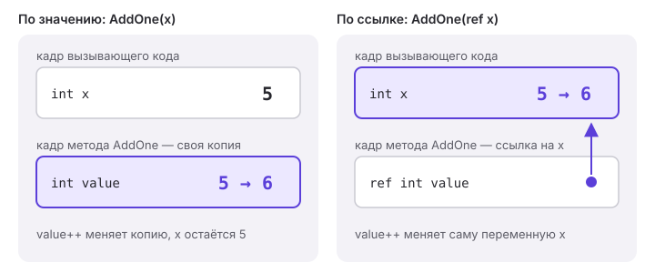

::::warmup

```quiz
id: by-value
type: output
prompt: Что выведет код?
code: |
  int x = 5;
  AddOne(x);
  Console.WriteLine(x);

  void AddOne(int value) => value++;
answer: "5"
explain: |
  Метод получил копию значения `x`. `value++` увеличивает копию, а переменная `x` снаружи остаётся 5. Как передать саму переменную — ниже.
variants:
  - code: |
      int x = 5;
      AddOne(ref x);
      Console.WriteLine(x);

      void AddOne(ref int value) => value++;
    answer: "6"
    explain: |
      С `ref` метод получает не копию, а ссылку на саму переменную `x`. `value++` меняет `x`.
  - code: |
      int x = 5;
      Increment(x);
      Console.WriteLine(x);

      int Increment(int value) => value + 1;
    explain: |
      Метод вернул 6, но результат никуда не сохранили. Сам `x` метод не менял: он получил копию значения.
```

::::

::::part Объявление и вызов

**Метод** — именованный блок кода, который можно вызвать. У метода есть тип результата, имя и параметры:

```csharp
int Max(int a, int b)
{
    if (a > b)
        return a;
    return b;
}

int bigger = Max(3, 7);  // 7
```

- **Тип результата** пишется перед именем. `void` — метод ничего не возвращает.
- **Параметры** — переменные метода, которые получают значения при вызове. Значения при вызове называют **аргументами**.
- **`return`** завершает метод и возвращает значение. В `void`-методе `return;` без значения просто выходит раньше.
- Имена методов пишут в стиле **PascalCase**: `Max`, `CalculateTotal`.

Компилятор проверяет, что метод с результатом возвращает значение **на любом пути выполнения**. Если хоть одна ветка может дойти до конца без `return`, это ошибка.

Метод из одного выражения можно записать короче, через `=>`:

```csharp
int Square(int n) => n * n;
```

**Где живут методы.** Обычно метод объявляют внутри класса, а вызывают через его имя: `Math.Max(3, 7)`. Классы — тема раздела про ООП. Пока достаточно двух форм:

- в файле с top-level statements метод можно объявить прямо в файле, как в примерах выше. Технически это **локальная функция** внутри сгенерированного `Main`, её можно вызвать и до объявления;
- в заданиях с кодом методы лежат в `public static class`: `static` значит, что метод вызывается через имя класса, без создания объекта.

Локальную функцию можно объявить и внутри любого другого метода, если она нужна только ему. Она видит переменные внешнего метода.

```quiz
id: missing-return
type: choice
prompt: Почему метод не компилируется?
code: |
  int Sign(int n)
  {
      if (n > 0)
          return 1;
      if (n < 0)
          return -1;
  }
options:
  - "Нельзя писать два return в одном методе"
  - "При n == 0 метод дойдёт до конца, не вернув значение"
  - "if без else запрещён в методах с результатом"
  - "Метод должен быть void, раз в нём есть if"
answer: 1
explain: |
  Компилятор проверяет все пути. При `n == 0` оба условия ложны, и выполнение доходит до закрывающей скобки без `return`. Нужен `return 0;` в конце.
variants:
  - code: |
      void Log(string message)
      {
          Console.WriteLine(message);
          return message.Length;
      }
    options:
      - "Метод void не может возвращать значение"
      - "Нельзя вызывать Console.WriteLine в методе"
      - "return должен стоять в первой строке"
      - "Параметр не может называться message"
    answer: 0
    explain: |
      `void` означает, что метод ничего не возвращает. В нём допустим только `return;` без значения. Чтобы вернуть длину, тип результата должен быть `int`.
```

::::

::::part Передача аргументов: значение, ref, out, in

**По умолчанию аргумент передаётся по значению:** метод получает копию. Что бы метод ни делал с параметром, переменная вызывающего кода не изменится.

Иногда метод должен изменить саму переменную. Для этого есть модификаторы, и их пишут и в объявлении, и при вызове — чтобы читающий видел, что переменная может измениться.



**`ref`** — передать ссылку на переменную. Метод может читать её и менять. Переменная должна получить значение **до** вызова.

```csharp
int a = 1, b = 2;
Swap(ref a, ref b);  // a = 2, b = 1

void Swap(ref int x, ref int y)
{
    int temp = x;
    x = y;
    y = temp;
}
```

**`out`** — передать переменную, в которую метод **обязан** записать результат. До вызова её можно не инициализировать, а внутри метода нельзя читать параметр, пока в него не записали. Так метод возвращает несколько значений. Самый известный пример — `TryParse`:

```csharp
if (int.TryParse("42", out int number))  // переменную можно объявить прямо в вызове
    Console.WriteLine(number + 1);       // 43

int.TryParse("abc", out _);  // _ — результат не нужен
```

`TryParse` возвращает `bool` — получилось ли разобрать строку, а само число кладёт в `out`-параметр. При неудаче он записывает туда 0 и не бросает исключение, в отличие от `Parse`.

**`in`** — передать ссылку только для чтения: копии нет, но менять параметр нельзя. Нужен для больших структур, о нём — на уровне Middle ниже.

| | Инициализировать до вызова | Метод должен присвоить | Метод может менять |
|---|---|---|---|
| без модификатора | да | нет | только свою копию |
| `ref` | да | нет | да |
| `out` | нет | да | да |
| `in` | да | нет | нет |

Что происходит, если передать без `ref` объект, а не число, — в теме про значимые и ссылочные типы. Там своя, очень частая на собеседованиях история.

```quiz
id: swap-ref
type: output
prompt: Что выведет код? Запись `$"{a} {b}"` подставляет значения переменных в строку через пробел.
code: |
  int a = 1, b = 2;
  Swap(ref a, ref b);
  Console.WriteLine($"{a} {b}");

  void Swap(ref int x, ref int y)
  {
      int temp = x;
      x = y;
      y = temp;
  }
answer: "2 1"
explain: |
  С `ref` метод работает с самими переменными `a` и `b`, поэтому обмен виден снаружи.
variants:
  - code: |
      int a = 1, b = 2;
      Swap(a, b);
      Console.WriteLine($"{a} {b}");

      void Swap(int x, int y)
      {
          int temp = x;
          x = y;
          y = temp;
      }
    answer: "1 2"
    explain: |
      Без `ref` метод получил копии. Он поменял местами свои `x` и `y`, а `a` и `b` остались прежними.
  - code: |
      int a = 1, b = 2;
      Twice(ref a);
      Twice(ref b);
      Console.WriteLine($"{a} {b}");

      void Twice(ref int x) => x *= 2;
    answer: "2 4"
    explain: |
      С `ref` каждый вызов удваивает саму переменную: `a` становится 2, `b` — 4.
```

```quiz
id: out-unassigned
type: find-bug
prompt: Метод не компилируется. В какой строке ошибка?
code: |
  bool TryHalf(int n, out int half)
  {
      if (n % 2 != 0)
          return false;
      half = n / 2;
      return true;
  }
answer: 4
explain: |
  Метод обязан записать значение в `out`-параметр на каждом пути выхода. На `return false;` в `half` ещё ничего не записано. Исправление — `half = 0;` перед этим `return`.
```

```quiz
id: ref-out-difference
type: choice
prompt: Чем `out` отличается от `ref`?
options:
  - "out передаёт копию, ref — ссылку"
  - "Переменную для out можно не инициализировать до вызова, но метод обязан её присвоить"
  - "out работает только с int"
  - "ref нельзя писать при вызове метода"
answer: 1
explain: |
  Оба передают ссылку на переменную. Для `ref` переменная должна иметь значение до вызова, а метод может её не трогать. Для `out` наоборот: значение до вызова не нужно, а метод обязан его записать.
```

:::level middle

**`in` и большие структуры.** Структура передаётся по значению целиком: структура в 64 байта копируется при каждом вызове. `in` передаёт ссылку и запрещает менять параметр. Но если структура не помечена `readonly`, вызов её метода через `in`-параметр может заставить компилятор сделать защитную копию: он не знает, не изменит ли метод поля. Поэтому `in` используют вместе с `readonly struct`. Подробнее — в теме про структуры.

**`ref`-возвраты.** Метод может вернуть ссылку на переменную, а не значение: `ref int Find(int[] items)`. Вызывающий код получает `ref int` и меняет элемент массива напрямую. Встречается в высокопроизводительном коде, вместе со `Span<T>`.

:::

::::

::::part Необязательные и именованные параметры, params

**Необязательный параметр** получает значение по умолчанию, если аргумент не передали. Такие параметры стоят после обязательных, а значение по умолчанию должно быть константой:

```csharp
int Price(int basePrice, int discount = 0, int tax = 20) => basePrice - discount + tax;

Price(100);                    // 120
Price(100, 10);                // 110
Price(100, tax: 0);            // 100: именованный аргумент, discount — по умолчанию
Price(tax: 5, basePrice: 50);  // 55: с именами порядок любой
```

**Именованные аргументы** пишут через двоеточие. Они позволяют пропустить необязательные параметры в середине и делают вызов понятнее, когда передают `true` или число без очевидного смысла: `Save(overwrite: true)`.

**`params`** позволяет передать любое количество аргументов через запятую. Внутри метода они собираются в массив:

```csharp
int Sum(params int[] numbers)
{
    int total = 0;
    foreach (int n in numbers)
        total += n;
    return total;
}

Sum(1, 2, 3);  // 6
Sum();         // 0: numbers — пустой массив, а не null
```

`params` может быть только один и только последним параметром. Так устроен, например, `string.Format("{0} и {1}", a, b)`.

```quiz
id: optional-named
type: output
prompt: Что выведет код?
code: |
  Console.WriteLine(Price(100, discount: 30));

  int Price(int basePrice, int discount = 0, int tax = 20) => basePrice - discount + tax;
answer: "90"
explain: |
  `discount` передан по имени — 30, `tax` не передан и берёт значение по умолчанию 20. Итого 100 − 30 + 20 = 90.
variants:
  - code: |
      Console.WriteLine(Price(100, tax: 0));

      int Price(int basePrice, int discount = 0, int tax = 20) => basePrice - discount + tax;
    answer: "100"
    explain: |
      Именованный аргумент задал `tax = 0`, а `discount` взял значение по умолчанию 0. Итого 100 − 0 + 0 = 100.
  - code: |
      Console.WriteLine(Price(100, 10));

      int Price(int basePrice, int discount = 0, int tax = 20) => basePrice - discount + tax;
    answer: "110"
    explain: |
      Позиционные аргументы заполняют параметры по порядку: `basePrice = 100`, `discount = 10`. `tax` — по умолчанию 20. Итого 110.
```

```quiz
id: params-empty
type: output
prompt: Что выведет код? `items.Length` — количество элементов массива.
code: |
  Console.WriteLine(Count());

  int Count(params int[] items) => items.Length;
answer: "0"
explain: |
  Без аргументов `params` даёт пустой массив, а не `null`, поэтому `items.Length` равен 0 и исключения нет.
variants:
  - code: |
      Console.WriteLine(Count(4, 8, 15, 16));

      int Count(params int[] items) => items.Length;
    answer: "4"
    explain: |
      Все аргументы через запятую собираются в один массив из четырёх элементов.
```

:::level middle

**Значение по умолчанию вписывается в вызывающий код.** Компилятор подставляет его в место вызова, а не берёт из метода при выполнении. Если библиотека поменяет значение по умолчанию, уже собранные программы продолжат передавать старое, пока их не пересоберут. Поэтому в публичных библиотеках вместо смены значения по умолчанию добавляют перегрузку.

**`params`-коллекции (C# 13).** `params` работает не только с массивами, но и с `Span<T>`, `ReadOnlySpan<T>`, `List<T>`, `IEnumerable<T>`. С `params ReadOnlySpan<T>` аргументы можно передать без выделения массива в куче.

:::

::::

::::part Перегрузка

Несколько методов могут называться одинаково, если у них разные **списки параметров**: количество, типы или модификаторы `ref`/`out`. Это **перегрузка** (overloading):

```csharp
void Print(int value) => Console.WriteLine($"int {value}");
void Print(long value) => Console.WriteLine($"long {value}");
void Print(double value) => Console.WriteLine($"double {value}");
void Print(string value) => Console.WriteLine($"string {value}");
```

**Тип результата перегрузки не различает.** Методы `int Parse(string s)` и `long Parse(string s)` с одинаковыми параметрами — ошибка: по вызову `Parse("5")` не понять, какой из них нужен.

Какую перегрузку выбрать, компилятор решает по типам аргументов:

1. Если есть перегрузка с точно таким типом, выбирается она: `Print(5)` — `int`, `Print(5L)` — `long`.
2. Если точной нет, выбирается та, до которой аргумент можно расширить «ближе всего»: `Print(5f)` — `double`, ведь для `float` перегрузки нет, а `float` расширяется до `double`.
3. Если подходящих несколько и ни одна не лучше другой, компилятор сообщает о неоднозначности.

Ловушка: `char` расширяется до `int`, поэтому `Print('A')` вызовет `Print(int)` и выведет `int 65`, а не букву.

```quiz
id: overload-pick
type: output
prompt: Что выведет код?
code: |
  Print(5f);

  void Print(int value) => Console.WriteLine("int");
  void Print(double value) => Console.WriteLine("double");
answer: double
explain: |
  Перегрузки для `float` нет. `float` неявно расширяется до `double`, а в `int` неявно не превращается, поэтому выбирается `Print(double)`.
variants:
  - code: |
      Print('A');

      void Print(int value) => Console.WriteLine("int");
      void Print(string value) => Console.WriteLine("string");
    answer: int
    explain: |
      `char` неявно расширяется до `int`, а в `string` сам не превращается. Поэтому вызывается `Print(int)`.
  - code: |
      byte small = 1;
      Print(small);

      void Print(int value) => Console.WriteLine("int");
      void Print(long value) => Console.WriteLine("long");
    answer: int
    explain: |
      `byte` расширяется и до `int`, и до `long`. Выбирается более близкое расширение — `int`, потому что `int` сам расширяется до `long`, а не наоборот.
```

::::

::::part Рекурсия

Метод, который вызывает сам себя, называется **рекурсивным**. Классический пример — факториал: n! = n × (n − 1)!.

```csharp
long Factorial(int n)
{
    if (n <= 1)
        return 1;                 // базовый случай: здесь рекурсия останавливается
    return n * Factorial(n - 1);  // рекурсивный вызов с меньшим n
}

Factorial(5);  // 120
```

У рекурсии всегда должен быть **базовый случай**, который не вызывает метод снова, и каждый вызов должен к нему приближаться.

Каждый вызов метода занимает место на **стеке вызовов**: там лежат его параметры и локальные переменные. Пока рекурсия не дошла до базового случая, кадры копятся. Стек ограничен — обычно около 1 МБ на поток, — и слишком глубокая или бесконечная рекурсия его переполняет.

Переполнение стека бросает `StackOverflowException`, но **перехватить его нельзя**: процесс сразу аварийно завершается. Поэтому рекурсию с неизвестной глубиной, например обход очень глубокого дерева, переписывают на цикл.

```quiz
id: recursion-output
type: output
prompt: Что выведет код?
code: |
  Console.WriteLine(Sum(4));

  int Sum(int n) => n == 0 ? 0 : n + Sum(n - 1);
answer: "10"
explain: |
  `Sum(4) = 4 + Sum(3) = 4 + 3 + Sum(2) = … = 4 + 3 + 2 + 1 + 0 = 10`. Базовый случай — `n == 0`.
variants:
  - code: |
      Console.WriteLine(Power(2, 5));

      int Power(int x, int n) => n == 0 ? 1 : x * Power(x, n - 1);
    answer: "32"
    explain: |
      Каждый вызов умножает на 2 и уменьшает `n`: 2 × 2 × 2 × 2 × 2 × 1 = 32. Базовый случай — `n == 0`, он возвращает 1.
  - code: |
      Console.WriteLine(Digits(4096));

      int Digits(int n) => n < 10 ? 1 : 1 + Digits(n / 10);
    answer: "4"
    explain: |
      Каждый вызов отрезает одну цифру и прибавляет 1: 4096 → 409 → 40 → 4. Базовый случай — однозначное число, он даёт 1.
```

```quiz
id: stack-overflow
type: choice
prompt: Что произойдёт, если рекурсия никогда не дойдёт до базового случая?
options:
  - "Программа зависнет навсегда"
  - "Бросится StackOverflowException, и процесс аварийно завершится, перехватить его нельзя"
  - "Бросится StackOverflowException, его можно поймать в try/catch и продолжить работу"
  - "Компилятор не соберёт такую программу"
answer: 1
explain: |
  Каждый вызов занимает место на стеке, и стек быстро кончается. `StackOverflowException` в .NET не перехватывается: процесс завершается сразу. Компилятор бесконечную рекурсию в общем случае не распознаёт.
```

::::

::::practice

```quiz
id: try-divide-task
type: code
lang: csharp
prompt: |
  Допишите метод по образцу `TryParse`: если `b` не равно 0, он записывает в `result` частное `a / b` и возвращает `true`. Если `b` равно 0 — записывает 0 и возвращает `false`, без исключения.
starter: |
  public static class Calc
  {
      public static bool TryDivide(int a, int b, out int result)
      {
      }
  }
tests: |
  Assert.True(Calc.TryDivide(7, 2, out var half));
  Assert.Equal(3, half);
  Assert.False(Calc.TryDivide(1, 0, out var none));
  Assert.Equal(0, none);
  Assert.True(Calc.TryDivide(-9, 3, out var negative));
  Assert.Equal(-3, negative);
solution: |
  public static class Calc
  {
      public static bool TryDivide(int a, int b, out int result)
      {
          if (b == 0)
          {
              result = 0;
              return false;
          }

          result = a / b;
          return true;
      }
  }
explain: |
  `out`-параметр нужно присвоить на каждом пути выхода, поэтому при `b == 0` в `result` явно записывается 0. Так устроены все `TryXxx`-методы .NET: успех — в результате метода, значение — в `out`.
variants:
  - prompt: |
      Допишите метод: он получает два числа и через `out`-параметры возвращает меньшее и большее из них.
    starter: |
      public static class Calc
      {
          public static void MinMax(int a, int b, out int min, out int max)
          {
          }
      }
    tests: |
      Calc.MinMax(3, 8, out var min1, out var max1);
      Assert.Equal(3, min1);
      Assert.Equal(8, max1);
      Calc.MinMax(5, -2, out var min2, out var max2);
      Assert.Equal(-2, min2);
      Assert.Equal(5, max2);
      Calc.MinMax(4, 4, out var min3, out var max3);
      Assert.Equal(4, min3);
      Assert.Equal(4, max3);
    solution: |
      public static class Calc
      {
          public static void MinMax(int a, int b, out int min, out int max)
          {
              if (a < b)
              {
                  min = a;
                  max = b;
              }
              else
              {
                  min = b;
                  max = a;
              }
          }
      }
    explain: |
      Оба `out`-параметра присваиваются в каждой ветке. Так метод возвращает два значения без отдельного типа для результата.
```

```quiz
id: power-task
type: code
lang: csharp
prompt: |
  Допишите рекурсивный метод: он возвращает `x` в степени `n` для `n >= 0`. Любое число в степени 0 — это 1.
starter: |
  public static class Calc
  {
      public static long Power(int x, int n)
      {
      }
  }
tests: |
  Assert.Equal(1L, Calc.Power(7, 0));
  Assert.Equal(32L, Calc.Power(2, 5));
  Assert.Equal(-27L, Calc.Power(-3, 3));
  Assert.Equal(10_000_000_000L, Calc.Power(10, 10));
solution: |
  public static class Calc
  {
      public static long Power(int x, int n)
      {
          if (n == 0)
              return 1;
          return x * Power(x, n - 1);
      }
  }
explain: |
  Базовый случай — `n == 0`, он возвращает 1. Каждый вызов уменьшает `n` на единицу и умножает результат на `x`. Тип `long` нужен, потому что 10¹⁰ не помещается в `int`.
variants:
  - prompt: |
      Допишите рекурсивный метод: он возвращает сумму чисел от 1 до `n` для `n >= 0`. Для 0 сумма — 0.
    starter: |
      public static class Calc
      {
          public static long SumTo(int n)
          {
          }
      }
    tests: |
      Assert.Equal(0L, Calc.SumTo(0));
      Assert.Equal(1L, Calc.SumTo(1));
      Assert.Equal(55L, Calc.SumTo(10));
      Assert.Equal(5050L, Calc.SumTo(100));
    solution: |
      public static class Calc
      {
          public static long SumTo(int n)
          {
              if (n == 0)
                  return 0;
              return n + SumTo(n - 1);
          }
      }
    explain: |
      Базовый случай — `n == 0`, сумма пустая. Иначе сумма до `n` — это `n` плюс сумма до `n - 1`.
```

::::

::::traps

- **По умолчанию метод получает копию аргумента.** Изменить переменную вызывающего кода можно только через `ref` или `out`.
- **`ref` и `out` пишут и в объявлении, и при вызове.**
- **`out`-параметр нужно присвоить на каждом пути выхода**, а `ref`-переменную — до вызова.
- **Тип результата не различает перегрузки.**
- **`char` выбирает перегрузку с `int`**, а не со `string`.
- **`params` без аргументов — пустой массив**, а не `null`.
- **`StackOverflowException` не перехватывается:** процесс завершается.

::::

::::summary

```quiz
id: methods-recall
type: recall
prompt: Как в C# передаются аргументы в метод? Чем отличаются ref, out и in? Что такое перегрузка?
answer: |
  По умолчанию аргумент передаётся **по значению**: метод получает копию, и переменная вызывающего кода не меняется.
  **`ref`** передаёт ссылку на переменную: метод может её читать и менять, переменная должна быть инициализирована до вызова. **`out`** тоже передаёт ссылку, но переменную можно не инициализировать, а метод обязан присвоить её на каждом пути выхода; так устроены `TryParse`-методы. **`in`** — ссылка только для чтения, нужна для больших структур. Модификаторы пишут и в объявлении, и при вызове.
  Необязательные параметры имеют значения по умолчанию, именованные аргументы позволяют передавать их в любом порядке, `params` собирает аргументы в массив (без аргументов — пустой).
  **Перегрузка** — методы с одним именем и разными списками параметров. Тип результата их не различает. Компилятор выбирает точное совпадение типов, иначе — ближайшее неявное расширение.
  Рекурсия требует базового случая; переполнение стека завершает процесс, его нельзя перехватить.
```

::::

::::test

```quiz
id: test-overload-return
type: choice
prompt: Что из этого не может отличать перегрузки метода?
options:
  - "Количество параметров"
  - "Типы параметров"
  - "Тип результата"
  - "Модификатор ref у параметра"
answer: 2
explain: |
  По вызову `Parse("5")` нельзя понять, какой тип результата нужен, поэтому методы, отличающиеся только им, — ошибка компиляции.
```

```quiz
id: test-ref-twice
type: output
prompt: Что выведет код?
code: |
  int total = 10;
  Add(ref total, 5);
  Add(ref total, 5);
  Console.WriteLine(total);

  void Add(ref int value, int amount) => value += amount;
answer: "20"
explain: |
  С `ref` каждый вызов меняет саму переменную `total`: 10 → 15 → 20.
variants:
  - code: |
      int total = 10;
      Add(total, 5);
      Add(total, 5);
      Console.WriteLine(total);

      void Add(int value, int amount) => value += amount;
    answer: "10"
    explain: |
      Без `ref` метод меняет только свою копию. `total` остаётся 10.
```

```quiz
id: test-out-init
type: choice
prompt: Какой вызов скомпилируется, если переменная объявлена как `int n;` без значения?
options:
  - "`Change(ref n);` для метода `void Change(ref int x)`"
  - "`Fill(out n);` для метода `void Fill(out int x)`"
  - "`Show(n);` для метода `void Show(int x)`"
  - "`Read(in n);` для метода `void Read(in int x)`"
answer: 1
explain: |
  Только для `out` переменная может не иметь значения до вызова: метод обязан его записать. Во всех остальных случаях метод может прочитать переменную, поэтому она должна быть инициализирована.
```

```quiz
id: test-overload-char
type: output
prompt: Что выведет код?
code: |
  Show('7');

  void Show(int value) => Console.WriteLine("число");
  void Show(string value) => Console.WriteLine("строка");
answer: число
explain: |
  `'7'` — это `char`, а не строка. `char` неявно расширяется до `int`, поэтому вызывается `Show(int)`.
variants:
  - code: |
      Show(7L);

      void Show(int value) => Console.WriteLine("int");
      void Show(double value) => Console.WriteLine("double");
    answer: double
    explain: |
      `7L` — `long`. В `int` он неявно не превращается, а в `double` — превращается, поэтому вызывается `Show(double)`.
```

::::
