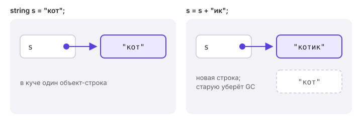

::::warmup

```quiz
id: to-upper-lost
type: output
prompt: Что выведет код?
code: |
  string s = "hello";
  s.ToUpper();
  Console.WriteLine(s);
answer: hello
explain: |
  `ToUpper` не меняет строку, а возвращает новую. Результат никуда не сохранили, и `s` осталась прежней. Строки в C# неизменяемы — об этом первая часть.
variants:
  - code: |
      string s = "hello";
      s = s.ToUpper();
      Console.WriteLine(s);
    answer: HELLO
    explain: |
      `ToUpper` возвращает новую строку, и здесь её записали обратно в `s`. Сама исходная строка при этом не менялась.
  - code: |
      string s = "  hi  ";
      s.Trim();
      Console.WriteLine(s.Length);
    answer: "6"
    explain: |
      `Trim` вернул новую строку без пробелов, но её не сохранили. Длина исходной строки — 6 символов вместе с пробелами.
```

::::

::::part Строка — неизменяемый объект

`string` — ссылочный тип, псевдоним `System.String`. Строка — последовательность символов `char` в кодировке UTF-16.

**Строку нельзя изменить.** Любой метод, который «меняет» строку, на самом деле создаёт новую, а старая остаётся как была:

```csharp
string s = "кот";
s = s + "ик";  // новая строка "котик"; "кот" никто не изменил
```



Поэтому частая ошибка — вызвать метод и не сохранить результат: `s.Trim();` ничего не делает с `s`.

Читать символы по индексу можно, записывать — нет:

```csharp
string word = "Hello";
char first = word[0];  // 'H'
word[0] = 'J';         // ошибка компиляции: индексатор только для чтения
```

Зачем неизменяемость: строку можно спокойно передавать куда угодно и использовать как ключ словаря — никто не поменяет её «из-под ног». Безопасно и для потоков: читать неизменяемый объект из нескольких потоков можно без блокировок.

**Самые нужные методы:**

| Метод | Пример | Результат |
|---|---|---|
| `Length` | `"кот".Length` | `3` |
| `ToUpper()`, `ToLower()` | `"Кот".ToUpper()` | `"КОТ"` |
| `Trim()` | `"  кот ".Trim()` | `"кот"` |
| `Substring(start, length)` | `"Override".Substring(1, 3)` | `"ver"` |
| `Replace(a, b)` | `"a-b-c".Replace("-", "+")` | `"a+b+c"` |
| `Contains`, `StartsWith`, `EndsWith` | `"report.pdf".EndsWith(".pdf")` | `true` |
| `IndexOf` | `"hello".IndexOf('l')` | `2`; `-1`, если нет |
| `Split` | `"a,b,c".Split(',')` | массив `{ "a", "b", "c" }` |
| `string.Join` | `string.Join("-", parts)` | `"a-b-c"` |
| `string.IsNullOrWhiteSpace` | `string.IsNullOrWhiteSpace("  ")` | `true` |

Пустая строка `""` (или `string.Empty`) — это строка без символов. Это не то же самое, что `null`, который означает «строки нет вовсе». У пустой строки можно вызвать `Length`, у `null` — нет.

```quiz
id: string-index-write
type: find-bug
prompt: Код не компилируется. В какой строке ошибка?
code: |
  string name = "anna";
  char first = name[0];
  name[0] = char.ToUpper(first);
  Console.WriteLine(name);
answer: 3
explain: |
  Строка неизменяема, и её индексатор только для чтения. Новую строку с заглавной буквой собирают, например, так: `char.ToUpper(name[0]) + name.Substring(1)`.
variants:
  - code: |
      string text = "abc";
      text.Length = 2;
      Console.WriteLine(text);
    answer: 2
    explain: |
      `Length` у строки только для чтения: строку нельзя укоротить на месте. Нужна новая строка: `text.Substring(0, 2)`.
```

```quiz
id: substring
type: output
prompt: Что выведет код?
code: |
  Console.WriteLine("Override".Substring(1, 3));
answer: ver
explain: |
  `Substring(start, length)` берёт `length` символов с индекса `start`. С индекса 1 три символа — `ver`.
variants:
  - code: |
      Console.WriteLine("Override".Substring(4));
    answer: ride
    explain: |
      С одним аргументом `Substring` берёт всё от индекса до конца. Индекс 4 — буква `r`.
  - code: |
      Console.WriteLine("a,b,,c".Split(',').Length);
    answer: "4"
    explain: |
      Между двумя запятыми подряд — пустая строка, она тоже становится элементом: `"a"`, `"b"`, `""`, `"c"`. Чтобы её отбросить, есть `StringSplitOptions.RemoveEmptyEntries`.
```

::::

::::part Сравнение строк

У строк `==` сравнивает **содержимое**, а не ссылки. Это исключение: для других ссылочных типов, например массивов, `==` по умолчанию сравнивает ссылки. Для строки оператор переопределён, потому что сравнивать текст нужно почти всегда.

```csharp
string a = "hello";
string b = "HELLO".ToLower();  // другой объект с тем же текстом
Console.WriteLine(a == b);     // True
```

**Регистр.** `==` учитывает регистр: `"Кот" == "кот"` — `false`. Для сравнения без учёта регистра не нужно вызывать `ToLower` у обеих строк, это создаёт две лишние строки. Лучше передать способ сравнения:

```csharp
bool same = string.Equals(a, b, StringComparison.OrdinalIgnoreCase);
bool hasPdf = fileName.EndsWith(".pdf", StringComparison.OrdinalIgnoreCase);
```

**Культура.** Сравнение и смена регистра могут зависеть от языка системы. Известный пример — турецкий язык: там у `i` заглавная `İ` с точкой, и `"file".ToUpper()` на турецкой системе даст не `"FILE"`. Поэтому:

- для идентификаторов, ключей, путей, протоколов — `StringComparison.Ordinal` или `OrdinalIgnoreCase` и `ToUpperInvariant()`: побайтовое сравнение, одинаковое везде;
- для текста, который видит человек (сортировка имён в интерфейсе), — сравнение с учётом культуры.

```quiz
id: string-equals
type: output
prompt: Что выведет код?
code: |
  string a = "hello";
  string b = "HELLO".ToLower();
  Console.WriteLine(a == b);
answer: "True"
explain: |
  `a` и `b` — разные объекты, но `==` у строк сравнивает содержимое, а оно одинаковое.
variants:
  - code: |
      string a = "Hello";
      string b = "hello";
      Console.WriteLine(a == b);
    answer: "False"
    explain: |
      `==` у строк учитывает регистр: `H` и `h` — разные символы.
  - code: |
      string a = "Hello";
      string b = "hello";
      Console.WriteLine(string.Equals(a, b, StringComparison.OrdinalIgnoreCase));
    answer: "True"
    explain: |
      `OrdinalIgnoreCase` сравнивает строки без учёта регистра.
```

::::

::::part Интерполяция и литералы

**Интерполяция** вставляет значения прямо в строку: перед кавычкой ставят `$`, значения пишут в фигурных скобках.

```csharp
string name = "Анна";
int age = 30;
string text = $"{name}, {age} лет";  // "Анна, 30 лет"
```

После двоеточия можно указать формат:

```csharp
$"{7:D3}"        // "007": целое не короче трёх цифр
$"{255:X}"       // "FF": шестнадцатеричная запись
$"{0.256:P1}"    // "25.6 %" или "25,6 %": проценты, знак зависит от культуры
$"{3.14159:F2}"  // "3.14" или "3,14": две цифры после запятой
```

Разделитель дробной части в форматах зависит от культуры системы: на русской будет запятая. Если строку читает программа, а не человек (JSON, CSV, логи), форматируют с `CultureInfo.InvariantCulture`.

**Буквальные строки.** Обычно `\` начинает спецсимвол: `\n`, `\t`, `\\`. В строке с `@` обратная косая черта — обычный символ. Это удобно для путей и регулярных выражений:

```csharp
string path = @"C:\Users\Anna\file.txt";  // без @ пришлось бы писать \\
```

**Сырые строки** (raw string literals, C# 11) начинаются и заканчиваются тремя кавычками. Внутри не нужно экранировать ни кавычки, ни `\`, и строка может занимать несколько строк. Отступ закрывающих кавычек убирается из каждой строки:

```csharp
string json = """
    {
        "name": "Анна",
        "age": 30
    }
    """;
```

```quiz
id: format-digits
type: output
prompt: Что выведет код?
code: |
  int code = 7;
  Console.WriteLine($"A-{code:D3}");
answer: A-007
explain: |
  Формат `D3` дополняет целое число нулями слева до трёх цифр.
variants:
  - code: |
      int value = 255;
      Console.WriteLine($"0x{value:X}");
    answer: "0xFF"
    explain: |
      Формат `X` выводит число в шестнадцатеричном виде: 255 — это `FF`.
  - code: |
      int done = 3;
      int total = 5;
      Console.WriteLine($"{done} из {total}");
    answer: 3 из 5
    explain: |
      Интерполяция подставляет значения переменных на место выражений в фигурных скобках.
```

```quiz
id: verbatim
type: choice
prompt: Как записать путь `C:\temp\new` так, чтобы `\t` и `\n` не превратились в табуляцию и перевод строки?
options:
  - "@\"C:\\temp\\new\""
  - "\"C:\\temp\\new\""
  - "$\"C:\\temp\\new\""
  - "'C:\\temp\\new'"
answer: 0
explain: |
  В строке с `@` обратная косая черта — обычный символ. Без `@` нужно удваивать каждую: `"C:\\temp\\new"`. `$` включает интерполяцию, а одинарные кавычки — для одного символа `char`.
```

::::

::::part StringBuilder

Раз строка неизменяема, каждое `+` создаёт новую строку и копирует в неё все символы. В цикле это становится дорогим:

```csharp
string result = "";
for (int i = 0; i < 10_000; i++)
    result += i;  // каждый раз новая строка всё большей длины
```

На каждом шаге копируется вся накопленная строка. Сумма копирований растёт как квадрат числа шагов: для 10 000 итераций — десятки миллионов скопированных символов и тысячи мусорных строк.

**`StringBuilder`** (пространство `System.Text`) хранит символы в изменяемом буфере. `Append` дописывает в буфер, а когда место кончается, буфер увеличивается сразу вдвое, а не на один символ. Строка создаётся один раз, в конце, методом `ToString()`:

```csharp
var builder = new StringBuilder();
for (int i = 0; i < 10_000; i++)
    builder.Append(i);
string result = builder.ToString();
```

`Append` возвращает тот же `StringBuilder`, поэтому вызовы можно склеивать в цепочку: `builder.Append("a").Append(1).AppendLine()`. Есть и `Insert`, `Remove`, `Replace`, `Clear`.

**Когда `StringBuilder` не нужен.** Если частей немного и их число известно, `+` или интерполяция ничуть не хуже: компилятор превращает `a + b + c` в один вызов `string.Concat`, который сразу выделяет строку нужной длины. Готовый массив склеивают через `string.Join`. `StringBuilder` нужен, когда строка собирается в цикле или по частям в разных местах.

```quiz
id: builder-why
type: choice
prompt: Почему для сборки строки в цикле берут StringBuilder, а не `+=`?
options:
  - "+= каждый раз создаёт новую строку и копирует в неё всё накопленное"
  - "+= в цикле не компилируется"
  - "StringBuilder сжимает текст"
  - "+= работает только с числами"
answer: 0
explain: |
  Строки неизменяемы, поэтому `+=` копирует всю строку на каждом шаге. `StringBuilder` дописывает в изменяемый буфер и создаёт строку один раз.
```

```quiz
id: builder-output
type: output
prompt: Что выведет код?
code: |
  var builder = new StringBuilder("кот");
  builder.Append("ик").Insert(0, "[").Append("]");
  Console.WriteLine(builder.ToString());
answer: "[котик]"
explain: |
  `Append` дописывает в конец, `Insert(0, ...)` — в начало. Каждый вызов возвращает тот же `StringBuilder`, поэтому их можно соединять в цепочку.
variants:
  - code: |
      var builder = new StringBuilder();
      for (int i = 1; i <= 3; i++)
          builder.Append(i).Append(';');
      Console.WriteLine(builder.ToString());
    answer: 1;2;3;
    explain: |
      На каждом шаге в буфер дописываются число и точка с запятой. Строка создаётся один раз — в `ToString()`.
```

:::level middle

**Интернирование.** Одинаковые строковые литералы в программе указывают на один объект: CLR хранит их в общей таблице (intern pool). Строки, созданные во время работы, туда не попадают:

```csharp
string a = "hello";
string b = "hello";
string c = new string(new[] { 'h', 'e', 'l', 'l', 'o' });

Console.WriteLine(ReferenceEquals(a, b));  // True: один литерал
Console.WriteLine(ReferenceEquals(a, c));  // False: строка создана при выполнении
Console.WriteLine(a == c);                 // True: содержимое одинаковое
```

`string.Intern(c)` вернёт объект из таблицы. Полагаться на интернирование в логике нельзя, сравнивают через `==` или `Equals`.

**Строка в памяти.** Объект строки — заголовок, указатель на тип, длина и символы по 2 байта. Пустая строка занимает около 22 байт, строка из 10 символов — около 42. Для разбора строк без создания подстрок есть `ReadOnlySpan<char>`: `text.AsSpan(0, 3)` смотрит на часть строки, ничего не копируя. Подробнее — в разделе «Память».

```quiz
id: interning
type: output
level: middle
prompt: Что выведет код?
code: |
  string a = "hi";
  string b = new string(new[] { 'h', 'i' });
  Console.WriteLine(ReferenceEquals(a, b));
answer: "False"
explain: |
  `b` создана во время выполнения и не интернирована, это отдельный объект. При этом `a == b` дало бы `True`: оператор сравнивает содержимое.
variants:
  - code: |
      string a = "hi";
      string b = "hi";
      Console.WriteLine(ReferenceEquals(a, b));
    answer: "True"
    explain: |
      Одинаковые литералы интернируются: обе переменные ссылаются на один объект из общей таблицы строк.
```

:::

::::

::::practice

```quiz
id: reverse-task
type: code
lang: csharp
prompt: |
  Допишите метод: он возвращает строку, записанную задом наперёд. Например, для «кот» — «ток».
starter: |
  public static class Text
  {
      public static string Reverse(string s)
      {
      }
  }
tests: |
  Assert.Equal("ток", Text.Reverse("кот"));
  Assert.Equal("", Text.Reverse(""));
  Assert.Equal("азор а", Text.Reverse("а роза"));
solution: |
  public static class Text
  {
      public static string Reverse(string s)
      {
          char[] chars = s.ToCharArray();
          Array.Reverse(chars);
          return new string(chars);
      }
  }
explain: |
  Строку нельзя перевернуть на месте, она неизменяема. `ToCharArray` даёт изменяемую копию символов, её переворачивают и собирают новую строку. Подошёл бы и `StringBuilder` с циклом с конца.
variants:
  - prompt: |
      Допишите метод: он проверяет, является ли строка палиндромом без учёта регистра — читается ли одинаково слева направо и справа налево. Например, «Шалаш» — палиндром.
    starter: |
      public static class Text
      {
          public static bool IsPalindrome(string s)
          {
          }
      }
    tests: |
      Assert.True(Text.IsPalindrome("Шалаш"));
      Assert.True(Text.IsPalindrome("казак"));
      Assert.False(Text.IsPalindrome("кот"));
      Assert.True(Text.IsPalindrome(""));
    solution: |
      public static class Text
      {
          public static bool IsPalindrome(string s)
          {
              string lower = s.ToLowerInvariant();
              for (int i = 0, j = lower.Length - 1; i < j; i++, j--)
              {
                  if (lower[i] != lower[j])
                      return false;
              }
              return true;
          }
      }
    explain: |
      Регистр приводят один раз, потом два индекса идут навстречу и сравнивают символы. Новую перевёрнутую строку создавать не нужно.
  - prompt: |
      Допишите метод: он возвращает число слов в строке. Слова разделены одним или несколькими пробелами, по краям тоже могут быть пробелы.
    starter: |
      public static class Text
      {
          public static int CountWords(string s)
          {
          }
      }
    tests: |
      Assert.Equal(3, Text.CountWords("один два три"));
      Assert.Equal(2, Text.CountWords("  много   пробелов "));
      Assert.Equal(0, Text.CountWords("   "));
      Assert.Equal(1, Text.CountWords("слово"));
    solution: |
      public static class Text
      {
          public static int CountWords(string s)
          {
              return s.Split(' ', StringSplitOptions.RemoveEmptyEntries).Length;
          }
      }
    explain: |
      `Split` по пробелу даёт пустые строки между соседними пробелами и по краям. `RemoveEmptyEntries` их отбрасывает, и остаются только слова.
```

```quiz
id: join-fill
type: fill
prompt: Вставьте метод, чтобы получить строку `"a-b-c"` из массива.
code: |
  string[] parts = { "a", "b", "c" };
  string result = string.___("-", parts);
answer: Join
caseSensitive: true
explain: |
  `string.Join` склеивает элементы через разделитель и сразу выделяет строку нужной длины.
```

::::

::::traps

- **Методы строки возвращают новую строку.** `s.Trim();` без присваивания ничего не меняет.
- **`s[0] = 'x'` не компилируется:** строка неизменяема.
- **`==` у строк сравнивает содержимое и учитывает регистр.** Без регистра — `StringComparison.OrdinalIgnoreCase`, а не `ToLower` с обеих сторон.
- **`ToUpper()` зависит от культуры.** Для служебных строк — `ToUpperInvariant()` и `Ordinal`-сравнение.
- **`+=` в цикле копирует всю строку на каждом шаге.** Для этого есть `StringBuilder`.
- **`""` и `null` — разные вещи.** Проверка на оба — `string.IsNullOrEmpty` или `IsNullOrWhiteSpace`.
- **Формат дробных чисел зависит от культуры:** где-то точка, где-то запятая.

::::

::::summary

```quiz
id: strings-recall
type: recall
prompt: Расскажите, почему строки в C# неизменяемы, что из этого следует и когда нужен StringBuilder.
answer: |
  `string` — ссылочный тип, но **неизменяемый**: любой «изменяющий» метод возвращает новую строку, а исходная остаётся. Поэтому результат `Trim`, `Replace`, `ToUpper` нужно сохранять. Неизменяемость делает строки безопасными для передачи, ключей словаря и работы из нескольких потоков.
  `==` у строк переопределён и сравнивает содержимое с учётом регистра. Без регистра и без зависимости от языка системы сравнивают через `StringComparison.OrdinalIgnoreCase`.
  Интерполяция `$"..."` подставляет значения и форматы; формат дробных чисел зависит от культуры. `@"..."` отключает спецсимволы, `"""..."""` — сырые многострочные строки.
  `+=` в цикле каждый раз копирует всю строку, поэтому сборку по частям делают в **`StringBuilder`**: изменяемый буфер, который растёт вдвое, а строка создаётся один раз в `ToString()`. Для нескольких известных частей хватает `+` или `string.Join`.
```

::::

::::test

```quiz
id: test-replace-lost
type: output
part: "Строка — неизменяемый объект"
prompt: Что выведет код?
code: |
  string s = "a-b";
  s.Replace("-", "+");
  Console.WriteLine(s);
answer: a-b
explain: |
  `Replace` вернул новую строку, но её не сохранили. Исходная строка не изменилась.
variants:
  - code: |
      string s = "a-b";
      string t = s.Replace("-", "+");
      Console.WriteLine(s + t);
    answer: a-ba+b
    explain: |
      `Replace` не трогает `s`, а возвращает новую строку `t`. Склеиваются обе.
```

```quiz
id: test-index-of
type: output
part: "Строка — неизменяемый объект"
prompt: Что выведет код?
code: |
  Console.WriteLine("hello".IndexOf('l'));
answer: "2"
explain: |
  Индексы с нуля: `h` — 0, `e` — 1, первая `l` — 2. `IndexOf` возвращает первое вхождение.
variants:
  - code: |
      Console.WriteLine("hello".IndexOf('z'));
    answer: "-1"
    explain: |
      Символа нет в строке, и `IndexOf` возвращает -1.
```

```quiz
id: test-empty-null
type: choice
part: "Строка — неизменяемый объект"
prompt: Чем пустая строка `""` отличается от `null`?
options:
  - "\"\" — строка без символов, а null — отсутствие строки: у null нельзя вызвать Length"
  - "Ничем, это одно и то же"
  - "\"\" занимает больше памяти, чем строка из одного символа"
  - "null — это строка из одного пробела"
answer: 0
explain: |
  У пустой строки `Length` равен 0. Обращение к члену у `null` бросает исключение. Проверить оба случая сразу — `string.IsNullOrEmpty`.
```

```quiz
id: test-contains-case
type: output
part: "Сравнение строк"
prompt: Что выведет код?
code: |
  Console.WriteLine("Hello".Contains("hello"));
answer: "False"
explain: |
  `Contains` по умолчанию учитывает регистр: `H` и `h` — разные символы. Без регистра — `Contains("hello", StringComparison.OrdinalIgnoreCase)`.
```

```quiz
id: test-ignore-case
type: choice
part: "Сравнение строк"
prompt: Какой способ сравнить строки без учёта регистра лучший?
options:
  - "string.Equals(a, b, StringComparison.OrdinalIgnoreCase)"
  - "a.ToLower() == b.ToLower()"
  - "a == b"
  - "a.Length == b.Length"
answer: 0
explain: |
  `ToLower` с обеих сторон создаёт две лишние строки и зависит от культуры системы. `OrdinalIgnoreCase` сравнивает сразу и одинаково на любой системе.
```

```quiz
id: test-string-ref
type: choice
part: "Сравнение строк"
prompt: Почему `==` для двух разных объектов-строк с одинаковым текстом даёт `true`, а для двух массивов с одинаковыми элементами — `false`?
options:
  - "У string оператор == переопределён и сравнивает содержимое, у массивов он сравнивает ссылки"
  - "Строки — значимый тип"
  - "Массивы нельзя сравнивать"
  - "Строки с одинаковым текстом — всегда один объект"
answer: 0
explain: |
  Строка — ссылочный тип, но для неё `==` переопределён. У массивов `==` остался ссылочным: равны только две ссылки на один массив.
```

```quiz
id: test-interpolation
type: output
part: "Интерполяция и литералы"
prompt: Что выведет код?
code: |
  int x = 4;
  Console.WriteLine($"{x} * {x} = {x * x}");
answer: 4 * 4 = 16
explain: |
  В фигурных скобках может стоять любое выражение, не только переменная: `{x * x}` вычисляется и подставляется.
```

```quiz
id: test-escape
type: output
part: "Интерполяция и литералы"
prompt: Сколько символов в строке `"a\tb"`? Что выведет код?
code: |
  Console.WriteLine("a\tb".Length);
answer: "3"
explain: |
  `\t` — один символ табуляции, записанный двумя знаками. В строке три символа: `a`, табуляция, `b`.
variants:
  - prompt: Что выведет код?
    code: |
      Console.WriteLine(@"a\tb".Length);
    answer: "4"
    explain: |
      В буквальной строке с `@` обратная косая черта — обычный символ, поэтому `\t` — два символа. Всего четыре.
```

```quiz
id: test-raw-string
type: choice
part: "Интерполяция и литералы"
prompt: Чем удобна сырая строка `"""..."""`?
options:
  - "Внутри не нужно экранировать кавычки и обратную косую черту, и строка может быть многострочной"
  - "Она занимает меньше памяти"
  - "Она изменяемая"
  - "Она автоматически переводит текст в верхний регистр"
answer: 0
explain: |
  Сырые строки удобны для JSON, SQL, регулярных выражений: текст пишется как есть, без `\"` и `\\`.
```

```quiz
id: test-builder-loop
type: choice
part: "StringBuilder"
prompt: В каком случае StringBuilder действительно нужен?
options:
  - "Строка собирается из тысяч частей в цикле"
  - "Нужно склеить имя и фамилию"
  - "Нужно вывести одно число"
  - "Нужно сравнить две строки"
answer: 0
explain: |
  Для пары-тройки частей `+` или интерполяция не хуже: компилятор сделает один `string.Concat`. Выигрыш `StringBuilder` даёт при сборке в цикле.
```

```quiz
id: test-builder-grow
type: choice
part: "StringBuilder"
prompt: Что делает StringBuilder, когда в буфере кончается место?
options:
  - "Выделяет буфер побольше, обычно вдвое, и продолжает дописывать"
  - "Бросает исключение"
  - "Создаёт новую строку на каждое добавление"
  - "Обрезает добавляемый текст"
answer: 0
explain: |
  Рост сразу в несколько раз делает добавление дешёвым в среднем: копирование случается редко.
```

```quiz
id: test-builder-tostring
type: output
part: "StringBuilder"
prompt: Что выведет код?
code: |
  var builder = new StringBuilder();
  builder.Append("ab").Append(3).Append('c');
  Console.WriteLine(builder.Length);
answer: "4"
explain: |
  В буфере `a`, `b`, `3`, `c` — четыре символа. `Append` принимает строки, числа и символы.
```

```quiz
id: test-intern-literal
type: choice
part: "StringBuilder"
level: middle
prompt: Какие строки интернируются автоматически?
options:
  - "Литералы, записанные в коде"
  - "Все строки, созданные программой"
  - "Только строки длиннее 85 000 символов"
  - "Никакие, только через string.Intern"
answer: 0
explain: |
  Литералы попадают в общую таблицу, и одинаковые литералы — один объект. Строки, собранные во время работы, не интернируются, пока не вызвать `string.Intern`.
```

::::
