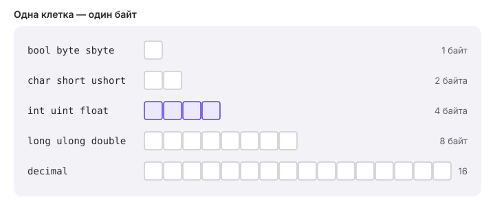

::::warmup

```quiz
id: double-sum
type: output
prompt: Что выведет код?
code: |
  double a = 0.1;
  double b = 0.2;
  Console.WriteLine(a + b == 0.3);
answer: "False"
explain: |
  Ноль целых одна десятая в `double` хранится не точно, а с крошечной погрешностью. Сумма получается 0.30000000000000004, и сравнение с 0.3 даёт `False`. Почему так и какой тип точный — в части про дробные числа.
```

::::

::::part Переменные

**Переменная** — именованное место в памяти для значения. При объявлении указывают тип и имя:

```csharp
int count = 5;  // объявление с начальным значением
string name = "Ann";
count = 10;     // присваивание нового значения
```

C# — язык со **статической типизацией**: тип переменной известен при компиляции и не меняется. Положить в `int` строку нельзя, это ошибка компиляции:

```csharp
int count = 5;
count = "пять";  // ошибка компиляции
```

**Прежде чем читать переменную, ей нужно присвоить значение.** Компилятор следит за этим сам:

```csharp
int total;
Console.WriteLine(total);  // ошибка компиляции: переменная не получила значения
```

**Область видимости.** Переменная существует внутри блока `{ }`, где её объявили. Снаружи блока её нет:

```csharp
if (true)
{
    int inside = 1;
}
Console.WriteLine(inside);  // ошибка: inside здесь не существует
```

Имена локальных переменных пишут в стиле **camelCase**: `orderCount`, `firstName`. Регистр важен: `count` и `Count` — разные имена.

```quiz
id: unassigned
type: find-bug
prompt: Код не компилируется. В какой строке ошибка?
code: |
  int total;
  int bonus = 10;
  Console.WriteLine(total + bonus);
answer: 3
explain: |
  Объявить `total` без значения можно, а прочитать — нет. Компилятор проверяет, что до чтения переменной ей присвоили значение, и останавливает сборку на строке, где её читают.
```

::::

::::part Целые числа

Целые типы различаются размером и наличием знака:

| Тип | Размер | Диапазон |
|---|---|---|
| `sbyte` / `byte` | 1 байт | −128…127 / 0…255 |
| `short` / `ushort` | 2 байта | −32 768…32 767 / 0…65 535 |
| `int` / `uint` | 4 байта | примерно ±2,1 млрд / 0…4,2 млрд |
| `long` / `ulong` | 8 байт | примерно ±9,2·10¹⁸ / 0…1,8·10¹⁹ |



Буква `u` значит unsigned, без знака: тот же размер, но только неотрицательные числа. По умолчанию для целых берут **`int`**, а когда значения могут превысить два миллиарда (идентификаторы, деньги в копейках, время в миллисекундах) — **`long`**. Беззнаковые типы в обычном коде встречаются редко.

Границы типа доступны как константы: `int.MaxValue` = 2 147 483 647, `int.MinValue` = −2 147 483 648.

**Литералы** — числа, записанные прямо в коде:

```csharp
int million = 1_000_000;   // подчёркивания для читаемости, на значение не влияют
int mask = 0xFF;           // шестнадцатеричная запись, 255
int flags = 0b1010;        // двоичная запись, 10
long big = 5_000_000_000;  // не помещается в int, поэтому литерал сам стал long
long small = 10L;          // суффикс L — литерал типа long
```

Целый литерал без суффикса получает **первый подходящий тип из `int`, `uint`, `long`, `ulong`**. Суффиксы задают тип явно: `L` — `long`, `U` — `uint`, `UL` — `ulong`.

**Тип результата не зависит от того, куда его кладут.** Произведение двух `int` — тоже `int`, даже если результат присваивают в `long`:

```csharp
int years = 100;
long seconds = years * 365 * 24 * 60 * 60;  // считается в int и переполняется
Console.WriteLine(seconds);                 // −1141367296 вместо 3153600000
```

Если значение не помещается в тип, лишние старшие биты отбрасываются, и число «заворачивается» через границу: `int.MaxValue + 1` даёт `int.MinValue`. Ошибки при этом нет. Как включить проверку переполнения — в следующей теме. Здесь достаточно сделать хотя бы один множитель `long`, тогда всё выражение считается в `long`:

```csharp
long seconds = years * 365L * 24 * 60 * 60;  // 3153600000
```

```quiz
id: int-wrap
type: output
prompt: Что выведет код?
code: |
  int x = int.MaxValue;
  x = x + 1;
  Console.WriteLine(x == int.MinValue);
answer: "True"
explain: |
  Результат не помещается в `int`, старший бит отбрасывается, и значение переходит через границу к самому маленькому `int`. Ошибки по умолчанию не будет.
```

```quiz
id: literal-type
type: input
prompt: Какой тип получит переменная `var n = 5000000000;`? Пять миллиардов больше, чем вмещают `int` и `uint`.
answer: long
explain: |
  Целый литерал без суффикса получает первый подходящий тип из `int`, `uint`, `long`, `ulong`. Пять миллиардов не помещаются в `int` (до 2,1 млрд) и в `uint` (до 4,2 млрд), поэтому литерал имеет тип `long`.
```

::::

::::part Дробные числа

| Тип | Размер | Точность | Суффикс | Когда брать |
|---|---|---|---|---|
| `float` | 4 байта | ~7 значащих цифр | `f` | графика, большие массивы, где важна память |
| `double` | 8 байт | ~15–16 значащих цифр | нет или `d` | вычисления, физика, статистика |
| `decimal` | 16 байт | 28–29 значащих цифр | `m` | **деньги** и всё, где нужна точная десятичная арифметика |

Литерал с точкой без суффикса — `double`. Поэтому так нельзя:

```csharp
decimal price = 19.99;  // ошибка: 19.99 — это double
float ratio = 0.5;      // ошибка: 0.5 — это double
decimal ok = 19.99m;    // ок
float alsoOk = 0.5f;    // ок
```

**Почему `0.1 + 0.2 != 0.3` в `double`.** `float` и `double` хранят число в **двоичном** виде. Дробь 0.1 в двоичной системе бесконечная, как 1/3 в десятичной: 0.000110011001100… Её приходится обрезать, и в переменной оказывается ближайшее представимое число, а не ровно 0.1. Погрешности складываются, и сумма получается 0.30000000000000004.

**`decimal`** хранит число в **десятичном** виде: целое число цифр и позицию запятой. 0.1, 0.2 и 0.3 записываются в нём точно, поэтому `0.1m + 0.2m == 0.3m` — `true`. Для денег это важно: копейки не должны теряться. Точен `decimal` только для десятичных дробей: 1/3 он тоже округлит, до 0.3333333333333333333333333333.

Сравнивать `double` через `==` после вычислений нельзя. Сравнивают с допуском:

```csharp
double sum = 0.1 + 0.2;
bool equal = Math.Abs(sum - 0.3) < 1e-9;  // true
```

```quiz
id: money-type
type: choice
prompt: Какой тип выбрать для суммы заказа в рублях с копейками?
options:
  - "float"
  - "double"
  - "decimal"
  - "int"
answer: 2
explain: |
  `decimal` хранит десятичные дроби точно, копейки не теряются при сложении и умножении. `float` и `double` двоичные и копят погрешность.
  Иногда деньги хранят в `long` целым числом копеек, но `int` для этого мал, а дробную часть он не хранит вовсе.
```

```quiz
id: decimal-literal
type: find-bug
prompt: Код не компилируется. В какой строке ошибка?
code: |
  int count = 3;
  decimal price = 19.99;
  decimal total = price * count;
answer: 2
explain: |
  `19.99` без суффикса — литерал типа `double`, а `double` в `decimal` неявно не превращается. Нужно `19.99m`.
```

:::level middle

**Как устроен `double`.** По стандарту IEEE 754: 1 бит знака, 11 бит порядка и 52 бита мантиссы. Число хранится как мантисса × 2^порядок. Отсюда ~15–16 точных десятичных цифр и огромный диапазон: до 1,8·10³⁰⁸.

**Особые значения.** Деление дробных чисел на ноль не бросает исключение:

```csharp
Console.WriteLine(1.0 / 0);                   // ∞ (double.PositiveInfinity)
Console.WriteLine(0.0 / 0);                   // NaN, «не число»
Console.WriteLine(double.NaN == double.NaN);  // False: NaN не равен ничему, даже себе
```

Проверять на `NaN` нужно через `double.IsNaN(x)`, а не через `==`.

**Цена `decimal`.** Арифметику `decimal` процессор не умеет выполнять напрямую, она реализована программно. Поэтому `decimal` в разы медленнее `double` и занимает 16 байт. Для денег это не важно, а для массовых вычислений берут `double`.

```quiz
id: nan-equal
type: output
level: middle
prompt: Что выведет код?
code: |
  double x = 0.0 / 0;
  Console.WriteLine(x == x);
answer: "False"
explain: |
  `0.0 / 0` даёт `NaN`. По стандарту IEEE 754 `NaN` не равен ничему, даже самому себе. Проверка — `double.IsNaN(x)`.
```

:::

::::

::::part char, bool и псевдонимы типов

**`char`** — один символ, 2 байта, в кодировке UTF-16. Литерал пишется в одинарных кавычках:

```csharp
char letter = 'A';
char newLine = '\n';    // перевод строки
char quote = '\'';      // одинарная кавычка
char omega = '\u03A9';  // Ω по коду Юникода
```

Внутри `char` — число, код символа. В арифметике он превращается в `int`:

```csharp
Console.WriteLine('A' + 1);          // 66: код 'A' — 65
Console.WriteLine((char)('A' + 1));  // B: явно превратили число обратно в символ
```

**`bool`** — `true` или `false`. В отличие от C и JavaScript, число в C# не превращается в `bool`: `if (1)` не компилируется, нужно явное сравнение `if (count != 0)`.

**Ключевые слова — псевдонимы типов .NET.** `int` — короткое имя для `System.Int32`, это один и тот же тип:

| C# | .NET | C# | .NET |
|---|---|---|---|
| `int` | `System.Int32` | `double` | `System.Double` |
| `long` | `System.Int64` | `decimal` | `System.Decimal` |
| `byte` | `System.Byte` | `char` | `System.Char` |
| `short` | `System.Int16` | `bool` | `System.Boolean` |

Поэтому у `int` есть члены, как у любого типа: `int.MaxValue`, `int.Parse("5")`. `string` — тоже псевдоним, для `System.String`, но устроена строка иначе, чем числа: ей посвящена отдельная тема.

```quiz
id: char-plus
type: output
prompt: Код символа `'A'` — 65. Что выведет код?
code: |
  Console.WriteLine('A' + 1);
answer: "66"
explain: |
  В арифметике `char` превращается в `int`: `'A' + 1` — это `65 + 1`. Чтобы получить символ `B`, результат приводят обратно: `(char)('A' + 1)`.
```

```quiz
id: alias
type: choice
prompt: Чем `int` отличается от `System.Int32`?
options:
  - "int меньше по размеру"
  - "Ничем: int — псевдоним System.Int32"
  - "int — значимый тип, а System.Int32 — ссылочный"
  - "System.Int32 работает только в старом .NET Framework"
answer: 1
explain: |
  Ключевые слова C# — короткие имена для типов .NET. `int x` и `System.Int32 x` компилируются одинаково.
```

::::

::::part var, const и значения по умолчанию

**`var`** просит компилятор вывести тип из значения справа:

```csharp
var count = 5;     // int
var big = 5L;      // long
var ratio = 5.0;   // double
var price = 5m;    // decimal
var name = "Ann";  // string
```

Это не динамическая типизация: тип выводится **при компиляции** и дальше не меняется. После `var count = 5;` строку в `count` не положить. Поэтому у `var` всегда должно быть значение, из которого виден тип: `var x;` и `var x = null;` не компилируются.

`var` удобен, когда тип и так виден справа: `var orders = new List<Order>();`. Когда справа вызов метода, по которому тип неочевиден, лучше написать его явно.

**`const`** — константа, значение которой известно при компиляции и никогда не меняется:

```csharp
const int MaxItems = 100;
const double Pi = 3.14159;
MaxItems = 200;  // ошибка компиляции
```

Значение `const` — литерал или выражение из других констант. Компилятор подставляет его прямо в места использования. Имена констант пишут в стиле PascalCase.

**Значения по умолчанию.** У каждого типа есть значение по умолчанию: `0` у чисел, `false` у `bool`, `'\0'` (символ с кодом 0) у `char`. Получить его можно через `default`:

```csharp
int zero = default;       // 0
bool no = default(bool);  // false
```

Локальная переменная значение по умолчанию сама **не получает**: пока ей ничего не присвоили, читать её нельзя, это вы уже видели. Поля классов, наоборот, заполняются значениями по умолчанию автоматически, об этом — в теме про классы.

```quiz
id: var-init
type: find-bug
prompt: Код не компилируется. В какой строке ошибка?
code: |
  var count;
  count = 5;
  Console.WriteLine(count);
answer: 1
explain: |
  Тип `var` выводится из значения при объявлении. Здесь значения нет, и компилятору не из чего узнать тип. Нужно `var count = 5;` или `int count;`.
```

```quiz
id: var-types
type: multi
prompt: В каких строках переменная получит тип `double`?
options:
  - "`var a = 1.5;`"
  - "`var b = 1.5f;`"
  - "`var c = 2.0;`"
  - "`var d = 2;`"
  - "`var e = 1.5m;`"
answer: [0, 2]
explain: |
  Литерал с точкой без суффикса — `double`, даже если дробная часть нулевая, как в `2.0`. Суффикс `f` делает `float`, `m` — `decimal`, а `2` без точки — `int`.
```

::::

::::practice

```quiz
id: seconds-task
type: code
lang: csharp
prompt: |
  Допишите метод: он получает число лет и возвращает, сколько в них секунд, если в году 365 дней. Результат вернуть оператором `return`, например `return 0;`.
  Учтите, что для 100 лет ответ больше `int.MaxValue`.
starter: |
  public static class Calc
  {
      public static long Seconds(int years)
      {
      }
  }
tests: |
  Assert.Equal(0L, Calc.Seconds(0));
  Assert.Equal(31_536_000L, Calc.Seconds(1));
  Assert.Equal(3_153_600_000L, Calc.Seconds(100));
solution: |
  public static class Calc
  {
      public static long Seconds(int years)
      {
          return years * 365L * 24 * 60 * 60;
      }
  }
explain: |
  `years * 365 * 24 * 60 * 60` считается в `int` и для 100 лет переполняется, хотя метод возвращает `long`. Суффикс `L` у одного из множителей переводит всё выражение в `long`.
```

```quiz
id: sizes-choice
type: choice
prompt: Сколько байт занимает `long`?
options:
  - "2"
  - "4"
  - "8"
  - "16"
answer: 2
explain: |
  `long` — 8 байт, `int` — 4, `short` — 2. 16 байт занимает `decimal`.
```

::::

::::traps

- **`0.1 + 0.2 == 0.3` в `double` — `false`.** Деньги считают в `decimal`, а `double` сравнивают с допуском.
- **Тип выражения не зависит от переменной слева.** `long x = a * b`, где `a` и `b` — `int`, переполнится раньше присваивания.
- **Переполнение `int` по умолчанию молчит:** число заворачивается через границу без ошибки.
- **`19.99` — это `double`.** Для `decimal` нужен суффикс `m`, для `float` — `f`.
- **`var` — не динамический тип.** Тип выводится при компиляции и фиксируется.
- **Локальная переменная не получает значение по умолчанию.** Её нужно инициализировать до чтения.

::::

::::summary

```quiz
id: variables-recall
type: recall
prompt: Какие встроенные числовые типы есть в C#, чем отличаются `double` и `decimal` и что делает `var`?
answer: |
  **Целые:** `byte` (1 байт), `short` (2), `int` (4), `long` (8), у каждого есть вариант со знаком и без. По умолчанию берут `int`, для больших значений — `long`. При переполнении число по умолчанию заворачивается через границу без ошибки.
  **Дробные:** `float` (4 байта) и `double` (8) хранят число в двоичном виде, поэтому 0.1 в них неточна и `0.1 + 0.2 != 0.3`. `decimal` (16 байт) хранит десятичное представление: точен для денег, но медленнее.
  Литерал с точкой — `double`; суффиксы `f`, `m`, `L` задают другой тип. Тип выражения считается по операндам, а не по переменной слева.
  `char` — символ UTF-16 и одновременно число, `bool` — только `true`/`false`. Ключевые слова — псевдонимы типов .NET: `int` = `System.Int32`.
  **`var`** выводит тип при компиляции, поэтому нужен инициализатор. **`const`** — значение, известное при компиляции. Локальную переменную нужно инициализировать до чтения.
```

::::

::::test

```quiz
id: test-decimal-sum
type: output
prompt: Что выведет код?
code: |
  decimal a = 0.1m;
  decimal b = 0.2m;
  Console.WriteLine(a + b == 0.3m);
answer: "True"
explain: |
  `decimal` хранит десятичное представление числа, и 0.1, 0.2, 0.3 записываются в нём точно. Сумма ровно 0.3.
```

```quiz
id: test-float-var
type: choice
prompt: Какой тип у переменной `var v = 3.0f;`?
options:
  - "int"
  - "float"
  - "double"
  - "decimal"
answer: 1
explain: |
  Суффикс `f` делает литерал `float`. Без суффикса `3.0` был бы `double`.
```

```quiz
id: test-default-bool
type: input
prompt: Чему равно `default(bool)`?
answer: "false"
explain: |
  Значение по умолчанию у `bool` — `false`, у чисел — `0`.
```

```quiz
id: test-overflow
type: choice
prompt: Что выведет код?
code: |
  int a = 50_000;
  int b = 50_000;
  long product = a * b;
  Console.WriteLine(product == 2_500_000_000);
options:
  - "True"
  - "False"
  - "Ошибка компиляции"
  - "Ошибка во время выполнения"
answer: 1
explain: |
  `a * b` считается в `int`: результат 2,5 млрд не помещается и заворачивается в отрицательное число. В `long` попадает уже неверное значение. Нужно `(long)a * b` или объявить `a` как `long`.
```

::::
