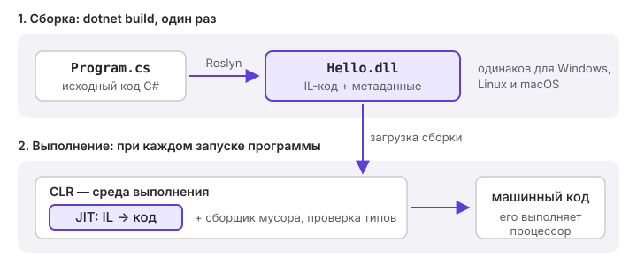

::::warmup

```quiz
id: dll-content
type: choice
prompt: Программу на C# собрали командой `dotnet build`, получился файл `Hello.dll`. Что в нём лежит?
options:
  - "Машинный код для процессора"
  - "Промежуточный код и описание типов"
  - "Исходный код C#, сжатый в архив"
  - "Байт-код Java"
answer: 1
explain: |
  Компилятор C# не создаёт машинный код. В `Hello.dll` лежит промежуточный код (IL) и метаданные — описание всех типов программы.
  Машинным кодом IL станет только при запуске. Как это происходит — ниже.
variants:
  - prompt: Что делает компилятор C# при команде `dotnet build`?
    options:
      - "Создаёт машинный код для процессора этого компьютера"
      - "Переводит код в IL и сохраняет его в сборку вместе с описанием типов"
      - "Запускает программу и проверяет, что она не падает"
      - "Скачивает и устанавливает .NET Runtime"
    answer: 1
    explain: |
      Компилятор C# создаёт сборку: IL-код и метаданные. Машинный код из IL сделает JIT уже при запуске программы.
```

::::

::::part Платформа и её версии

**.NET** — платформа для программ на C#. В неё входят:

- **среда выполнения** — запускает программу, выделяет и освобождает память;
- **библиотеки** — тысячи готовых классов: коллекции, файлы, сеть, JSON, даты;
- **инструменты** — компилятор и команда `dotnet`, которой создают, собирают и запускают проекты;
- **языки** — C#, F# и Visual Basic. Все три работают поверх одной среды и одних библиотек.

Название «.NET» за двадцать с лишним лет носили разные продукты, поэтому сначала коротко об истории:

| Платформа | Годы | Где работает | Статус |
|---|---|---|---|
| .NET Framework 1.0–4.8.1 | 2002–2022 | только Windows | поддерживается как часть Windows, новых возможностей нет |
| .NET Core 1.0–3.1 | 2016–2019 | Windows, Linux, macOS | написана заново, открытый код; версии уже не поддерживаются |
| .NET 5 и новее | с 2020 | Windows, Linux, macOS | продолжение .NET Core; слово Core из названия убрали |

Когда говорят «.NET» без уточнений, имеют в виду современную линию: .NET 5, 6 и дальше до текущих версий. Старый .NET Framework встречается в давних проектах на Windows.

**Как выходят версии.** Новая версия выходит каждый год в ноябре. Чётные версии — **LTS** (Long Term Support), их поддерживают 3 года. Нечётные — **STS** (Standard Term Support), их поддерживают 2 года. Качество у них одинаковое, отличается только срок исправлений. Сейчас актуальны:

- **.NET 10** — LTS, вышла в ноябре 2025 года, поддерживается до ноября 2028 года;
- **.NET 11** — STS, вышла в ноябре 2026 года.

Вместе с каждой версией .NET выходит новая версия языка: C# 14 по умолчанию идёт с .NET 10, C# 15 — с .NET 11. Проекты, которым нужна долгая поддержка без ежегодных обновлений, обычно держат на LTS.

```quiz
id: framework-windows
type: choice
prompt: Какая из платформ работает только на Windows?
options:
  - ".NET Framework 4.8"
  - ".NET Core 3.1"
  - ".NET 8"
  - ".NET 10"
answer: 0
explain: |
  .NET Framework создавался для Windows и на других системах не работает. .NET Core и все версии начиная с .NET 5 — кросс-платформенные.
```

```quiz
id: lts-sts
type: choice
prompt: Чем LTS-версия .NET отличается от STS-версии?
options:
  - "LTS работает быстрее"
  - "LTS дольше получает исправления: 3 года против 2"
  - "STS экспериментальная, её нельзя использовать в продакшене"
  - "LTS работает только на Windows"
answer: 1
explain: |
  Качество и стабильность у них одинаковые, отличается только срок поддержки. Чётные версии (.NET 8, 10) — LTS, нечётные (.NET 9, 11) — STS.
variants:
  - prompt: Через год выйдет .NET 12. Какой у неё будет срок поддержки?
    options:
      - "LTS, 3 года"
      - "STS, 2 года"
      - "1 год"
      - "Никакого: это будет предварительная версия"
    answer: 0
    explain: |
      Чётные версии — LTS с поддержкой 3 года, нечётные — STS с поддержкой 2 года. Версия выходит раз в год, в ноябре.
  - prompt: Какой срок поддержки у .NET 11?
    options:
      - "LTS, 3 года"
      - "STS, 2 года"
      - "1 год"
      - "Никакого: это предварительная версия"
    answer: 1
    explain: |
      Нечётные версии — STS, их поддерживают 2 года. Качество у них такое же, как у LTS, отличается только срок.
```

::::

::::part Путь кода: от файла до процессора

Программа на C# проходит два этапа.

**1. Сборка.** Компилятор C# (он называется **Roslyn**) проверяет код и переводит его в **IL** (Intermediate Language, промежуточный язык; ещё называют CIL и MSIL). Результат — **сборка**: файл `.dll`, в котором лежат IL-код и описание всех типов.

**2. Выполнение.** При запуске программы среда выполнения **CLR** (Common Language Runtime) загружает сборку. Процессор не понимает IL, поэтому CLR переводит его в машинный код. Это делает **JIT-компилятор** (Just-In-Time, «точно вовремя»): каждый метод компилируется при **первом вызове**, готовый машинный код запоминается и при следующих вызовах используется сразу.



Как выглядит IL. Метод на C#:

```csharp
static int Sum(int a, int b) => a + b;
```

В сборке он превращается примерно в такие инструкции:

```text
ldarg.0  // положить на стек вычислений первый аргумент
ldarg.1  // положить второй аргумент
add      // сложить два верхних значения
ret      // вернуть результат
```

IL похож на ассемблер, но не привязан к конкретному процессору.

**Зачем два этапа, если можно сразу собрать машинный код:**

- **Одна сборка для всех систем.** Один и тот же `.dll` запускается на Windows, Linux и macOS, на процессорах Intel и ARM. Под конкретную машину код подгоняет JIT при запуске.
- **Языки совместимы.** C#, F# и Visual Basic компилируются в один и тот же IL. Библиотеку на F# можно вызвать из C#, как обычную.
- **Среда контролирует выполнение.** CLR видит каждый тип и каждый вызов, поэтому может проверять типы и сама освобождать память.

Код, который выполняется под управлением CLR, называют **управляемым** (managed). Код, который работает без неё, — например, библиотеки на C++, — **неуправляемым** (unmanaged).

```quiz
id: jit-when
type: choice
prompt: Когда JIT-компилятор переводит метод в машинный код?
options:
  - "При сборке проекта командой dotnet build"
  - "При первом вызове этого метода"
  - "При запуске программы, сразу все методы"
  - "При каждом вызове метода заново"
answer: 1
explain: |
  JIT компилирует метод в момент первого вызова и запоминает результат. Повторные вызовы используют готовый машинный код.
  Метод, который ни разу не вызвали, не компилируется вовсе.
variants:
  - prompt: Метод есть в программе, но за всё время работы его ни разу не вызвали. Что с ним сделает JIT?
    options:
      - "Скомпилирует при запуске программы, вместе с остальными"
      - "Не скомпилирует вовсе"
      - "Скомпилирует ещё при сборке проекта"
      - "Скомпилирует при завершении программы"
    answer: 1
    explain: |
      JIT компилирует метод в момент первого вызова. Нет вызова — нет компиляции: IL метода так и останется в сборке.
```

```quiz
id: il-name
type: input
prompt: Как называется промежуточный код, который компилятор C# кладёт в сборку? Ответ — аббревиатура.
answer: [IL, CIL, MSIL]
explain: |
  IL (Intermediate Language) — промежуточный язык. Его же называют CIL (Common Intermediate Language) и, по-старому, MSIL.
```

:::level middle

**JIT не один раз.** Современный JIT работает в несколько уровней (tiered compilation):

1. **Уровень 0** — при первом вызове метод компилируется быстро и почти без оптимизаций. Программа стартует быстрее.
2. **Уровень 1** — если метод вызывают часто (примерно от 30 вызовов), JIT в фоне компилирует его заново, уже с полными оптимизациями, и подменяет.

С .NET 8 по умолчанию включён **dynamic PGO**: на уровне 0 JIT собирает статистику (какие ветки выполняются, какие типы реально приходят) и использует её при оптимизации на уровне 1. Для длинных циклов есть **OSR**: метод можно переключить на оптимизированную версию прямо посреди цикла.

**Можно обойтись без JIT при запуске:**

| Способ | Что делает | Плюсы | Минусы |
|---|---|---|---|
| **ReadyToRun** | кладёт в сборку готовый машинный код рядом с IL | быстрее старт | файлы больше; горячие методы JIT всё равно перекомпилирует |
| **Native AOT** | компилирует всё приложение в машинный код заранее | мгновенный старт, меньше памяти, .NET на машине не нужен | нельзя загружать сборки и генерировать код во время работы, рефлексия ограничена |

Native AOT выбирают для консольных утилит, контейнеров и serverless, где важен старт. Для обычного веб-сервиса чаще оставляют JIT: после прогрева он может оптимизировать код лучше, потому что видит реальную нагрузку.

```quiz
id: aot-limits
type: choice
level: middle
prompt: Чего нельзя делать в приложении, скомпилированном через Native AOT?
options:
  - "Работать с файлами"
  - "Загружать сборки во время работы программы"
  - "Использовать коллекции и LINQ"
  - "Запускаться на Linux"
answer: 1
explain: |
  Native AOT компилирует всё заранее, JIT в приложении нет. Поэтому новый IL во время работы выполнить нечем: ни загруженную сборку, ни сгенерированный код.
  Файлы, коллекции, LINQ и Linux работают.
```

:::

::::

::::part Что делает CLR и из чего состоит платформа

**CLR** — не только JIT. Среда выполнения:

- **загружает сборки** — по мере того как программе нужны их типы;
- **компилирует IL** в машинный код через JIT;
- **управляет памятью** — выделяет место под объекты и сама освобождает его, когда объект больше не нужен. Это делает **сборщик мусора** (GC), ему посвящён раздел «Память»;
- **проверяет типы** — например, неверное приведение типа заканчивается понятной ошибкой, а не порчей памяти;
- **обрабатывает исключения** и управляет потоками.

**Сборка** — единица, в которой распространяется код. В ней три части:

- **IL-код** всех методов;
- **метаданные** — описание каждого типа: его поля, методы, параметры. По ним компилятор проверяет вызовы в другие сборки, а редактор показывает подсказки;
- **манифест** — имя и версия сборки и список сборок, от которых она зависит.

У консольного приложения после сборки рядом лежат `Hello.dll` и `Hello.exe`. Сама программа — в `Hello.dll`. `Hello.exe` — маленький запускатель, который находит .NET и передаёт ему сборку. Ту же программу можно запустить без него: `dotnet Hello.dll`.

**Библиотеки.** Вместе с .NET идёт **BCL** (Base Class Library, базовая библиотека классов): типы `System.Console`, `System.String`, коллекции, работа с файлами, сетью, JSON. Всё остальное подключают **NuGet-пакетами**. NuGet — менеджер пакетов .NET, а nuget.org — главный каталог пакетов, примерно как npm для JavaScript.

**SDK и Runtime.** .NET устанавливается в двух видах:

| Что | Для чего | Что внутри |
|---|---|---|
| **Runtime** | запускать готовые программы | CLR и библиотеки. Отдельно есть ASP.NET Core Runtime для веб-приложений и Desktop Runtime для оконных |
| **SDK** | писать программы | Runtime плюс компилятор, команда `dotnet` и шаблоны проектов |

На машине разработчика ставят SDK, на сервере, где программа только работает, достаточно Runtime.

```quiz
id: clr-does
type: multi
prompt: Что делает CLR?
options:
  - "Компилирует код C# в IL"
  - "Переводит IL в машинный код"
  - "Освобождает память, которая больше не используется"
  - "Проверяет приведения типов во время выполнения"
  - "Скачивает NuGet-пакеты"
answer: [1, 2, 3]
explain: |
  C# в IL переводит компилятор Roslyn ещё при сборке, а пакеты скачивает команда `dotnet`. CLR работает при выполнении: JIT, сборка мусора, проверки типов.
variants:
  - options:
      - "Загружает сборки, когда программе нужны их типы"
      - "Проверяет синтаксис кода на C#"
      - "Обрабатывает исключения"
      - "Создаёт файл проекта .csproj"
      - "Управляет потоками"
    answer: [0, 2, 4]
    explain: |
      Синтаксис проверяет компилятор при сборке, а `.csproj` создаёт команда `dotnet new`. CLR работает во время выполнения: загружает сборки, обрабатывает исключения, управляет потоками и памятью.
```

```quiz
id: sdk-runtime
type: choice
prompt: На сервере будут только запускать уже собранное приложение. Что нужно установить?
options:
  - "SDK"
  - "Runtime"
  - "Visual Studio"
  - "Только NuGet"
answer: 1
explain: |
  Для запуска нужен только Runtime: CLR и библиотеки. SDK нужен, чтобы собирать программы, на сервере он лишний.
```

:::level middle

**CTS и CLS.** Языки .NET совместимы благодаря двум спецификациям:

- **CTS** (Common Type System) — общая система типов. Для всех языков `int` в C# и `Integer` в Visual Basic — один и тот же тип `System.Int32`.
- **CLS** (Common Language Specification) — набор правил для публичного API, который поймёт любой язык .NET. Например, беззнаковые типы вроде `uint` не входят в CLS: в некоторых языках их нет.

**Framework-dependent и self-contained.** По умолчанию приложение публикуется без .NET внутри и требует установленный Runtime (framework-dependent). С флагом `--self-contained` Runtime кладётся рядом с приложением: на сервер ничего ставить не нужно, но размер вырастает на десятки мегабайт.

:::

::::

::::traps

- **«C# компилируется в машинный код».** Нет: в IL. Машинный код появляется при запуске, через JIT. Исключение — Native AOT.
- **«JIT компилирует всю программу при запуске».** Нет: каждый метод — при первом вызове.
- **«.NET Core и .NET — разные платформы».** .NET 5 и новее — прямое продолжение .NET Core, сменилось только название.
- **«Программа лежит в `Hello.exe`».** Код в `Hello.dll`, `.exe` только запускает его.
- **«STS — бета-версия».** Качество у STS и LTS одинаковое, отличается только срок поддержки.

::::

::::summary

```quiz
id: dotnet-recall
type: recall
prompt: Расскажите, как код на C# превращается в работающую программу и что делает CLR.
answer: |
  При сборке компилятор Roslyn переводит C# в **IL** — промежуточный код, не привязанный к процессору — и кладёт его в **сборку** (`.dll`) вместе с метаданными о типах.
  При запуске **CLR** загружает сборку, и **JIT** переводит каждый метод в машинный код при первом вызове.
  Кроме этого CLR управляет памятью через сборщик мусора, проверяет типы и обрабатывает исключения. Код под её управлением называется управляемым.
  Два этапа нужны, чтобы одна сборка работала на любой системе и процессоре, а языки .NET были совместимы между собой.
```

::::

::::test

```quiz
id: test-metadata
type: choice
prompt: Что хранят метаданные сборки?
options:
  - "Машинный код методов"
  - "Описание типов: их поля, методы и параметры"
  - "Настройки сборщика мусора"
  - "Исходный код программы"
answer: 1
explain: |
  Метаданные описывают каждый тип сборки. По ним компилятор проверяет вызовы из других проектов, а редактор показывает подсказки.
variants:
  - prompt: Что хранит манифест сборки?
    options:
      - "Имя и версию сборки и список сборок, от которых она зависит"
      - "IL-код методов"
      - "Машинный код для процессора"
      - "Настройки JIT-компилятора"
    answer: 0
    explain: |
      Манифест описывает саму сборку: как она называется, какой версии и что ей нужно для работы. IL-код и описание типов лежат в других частях сборки.
```

```quiz
id: test-managed
type: choice
prompt: Какой код называют управляемым?
options:
  - "Код, который проверили тесты"
  - "Код, который выполняется под управлением CLR"
  - "Код, скомпилированный в Release"
  - "Код без исключений"
answer: 1
explain: |
  Управляемый код выполняет CLR: она компилирует его через JIT, освобождает память и проверяет типы. Неуправляемый работает напрямую, без среды, например библиотеки на C++.
variants:
  - prompt: Какой код называют неуправляемым?
    options:
      - "Библиотеку на C++, которая работает без CLR"
      - "Метод на C# без комментариев"
      - "Код, собранный в конфигурации Debug"
      - "Код без обработки исключений"
    answer: 0
    explain: |
      Неуправляемый код выполняется напрямую, без CLR: сборщик мусора и проверки типов его не касаются. Любой код на C# под CLR — управляемый.
```

```quiz
id: test-clr-name
type: input
prompt: Как называется среда выполнения .NET, которая загружает сборки и запускает JIT? Ответ — аббревиатура.
answer: CLR
explain: |
  CLR — Common Language Runtime, общая среда выполнения для всех языков .NET.
variants:
  - prompt: Как называется компилятор, который во время работы программы переводит IL в машинный код? Ответ — аббревиатура.
    answer: JIT
    explain: |
      JIT — Just-In-Time, компиляция «точно вовремя»: каждый метод переводится в машинный код при первом вызове.
```

```quiz
id: test-languages
type: choice
prompt: Почему библиотеку, написанную на F#, можно вызвать из C#?
options:
  - "Компилятор C# умеет читать код на F#"
  - "Оба языка компилируются в один и тот же IL"
  - "F# — часть языка C#"
  - "Библиотеку при установке переписывают на C#"
answer: 1
explain: |
  После компиляции язык уже не важен: сборка содержит IL и метаданные, одинаковые для всех языков .NET.
variants:
  - prompt: Что общего у сборок, собранных из кода на C# и из кода на F#?
    options:
      - "Обе содержат IL-код и метаданные"
      - "Обе содержат готовый машинный код"
      - "Обе работают только на Windows"
      - "Ничего: их нельзя использовать вместе"
    answer: 0
    explain: |
      Все языки .NET компилируются в IL с метаданными. Поэтому сборки на разных языках работают вместе и выполняются одной CLR.
```

::::
