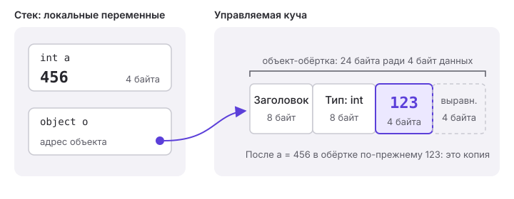
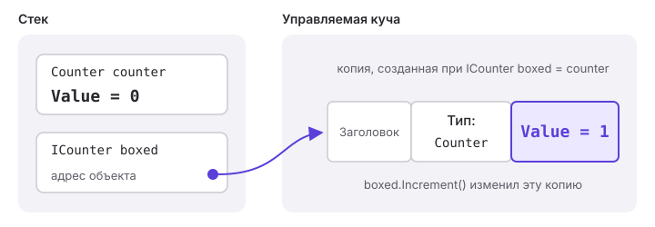

::::warmup

```quiz
id: boxing-copy
type: output
prompt: Что выведет код?
code: |
  int a = 123;
  object o = a;
  a = 456;
  Console.WriteLine(o);
answer: "123"
explain: |
  `object o = a` кладёт в `o` не саму переменную `a`, а **копию** её значения в отдельном объекте.
  Поэтому `a = 456` на `o` не влияет. Почему так — ниже.
variants:
  - code: |
      int a = 5;
      object o = a;
      a++;
      Console.WriteLine(o);
    answer: "5"
    explain: |
      `object o = a` кладёт в `o` копию значения в отдельном объекте. `a++` меняет только переменную `a`, обёртка хранит прежние 5.
```

::::

::::part Что происходит в памяти

Возьмём две строки:

```csharp
int a = 123;
object o = a;
```

`a` — значимая переменная: в ней лежат сами 4 байта числа. `o` — ссылочная: в ней лежит только адрес объекта в куче. Но числа 123 в куче нет. Значит, при присваивании среда должна его туда положить:

1. Создать в куче объект-обёртку.
2. Скопировать в него значение `a`.
3. Записать адрес обёртки в `o`.

Это и есть **boxing** (упаковка): значимое значение копируется в объект в куче, чтобы на него можно было сослаться.



Из чего состоит обёртка:

| Часть | Размер (64 бита) | Зачем |
|---|---|---|
| Заголовок | 8 байт | служебные данные среды, есть у каждого объекта |
| Указатель на тип | 8 байт | «здесь лежит `int`»; по нему работает проверка при распаковке |
| Значение | 4 байта | само число |
| Выравнивание | 4 байта | объекты занимают кратно 8 байтам |

Итого **24 байта ради 4 байт данных**, плюс эту память потом должен освободить сборщик мусора.

На одном значении это незаметно. В цикле — уже да:

```csharp
var list = new ArrayList();  // хранит object
for (int i = 0; i < 1_000_000; i++)
    list.Add(i);             // Add(object) → каждый i упаковывается
```

Миллион обёрток по 24 байта — около 24 МБ в куче только на коробки, и всё это сборщик мусора потом обходит и чистит. Обычный массив `int[1_000_000]` занимает 4 МБ одним блоком. Как хранить числа в коллекции без упаковки, разбирается в теме Generics.

**Правило:** упаковка происходит, когда значение значимого типа попадает туда, где ожидается ссылка:

```csharp
object o = 5;       // переменная типа object
IComparable c = 5;  // переменная интерфейсного типа: int реализует IComparable
list.Add(5);        // параметр типа object (ArrayList.Add(object))
```

```quiz
id: boxing-where
type: multi
prompt: В каких строках происходит boxing?
options:
  - "`object o = 5;`"
  - "`string s = \"5\";`"
  - "`IComparable c = 5;`"
  - "`int x = 5; long y = x;`"
  - "`var list = new ArrayList(); list.Add(5);`"
answer: [0, 2, 4]
explain: |
  `string` — ссылочный тип, строка и так живёт в куче, упаковывать нечего.
  `long y = x` — превращение числа в более широкое число, ссылки здесь нет.
  В остальных трёх строках `int` попадает в `object` или интерфейс, поэтому создаётся обёртка.
```

::::

::::part Unboxing: обратно из обёртки

**Unboxing** (распаковка) — явное приведение объекта обратно к значимому типу:

```csharp
object o = 123;
int a = (int)o;
```

Среда делает два шага:

1. **Проверяет тип:** смотрит указатель на тип в обёртке. Там `int`, приводим к `int` — совпало.
2. **Копирует** 4 байта значения в `a`.

Распаковка ничего не преобразует, она только достаёт значение. Поэтому достать можно только тот тип, который был упакован:

o проходит, (long)o падает")

```csharp
object o = 123;

int a = (int)o;         // ок
long b = (long)o;       // ошибка во время выполнения: в обёртке int, а не long
long c = (long)(int)o;  // ок: распаковали int, потом обычным приведением сделали long
```

Почему компилятор не ловит `(long)o` заранее: у `o` тип `object`, в нём может оказаться что угодно. Что лежит внутри, известно только во время выполнения. Ошибка, которую бросит программа, называется `InvalidCastException`.

```quiz
id: unboxing-runtime
type: choice
prompt: Что произойдёт при выполнении этого кода?
code: |
  object o = 123;
  long b = (long)o;
  Console.WriteLine(b);
options:
  - "Выведет 123"
  - "Ошибка компиляции"
  - "Ошибка во время выполнения"
answer: 2
explain: |
  Компилятор пропустит код: `o` объявлен как `object`, и приведение к `long` теоретически возможно.
  Во время выполнения проверка увидит в обёртке `int` вместо `long`, и программа упадёт.
variants:
  - code: |
      object o = 1.5;
      float f = (float)o;
      Console.WriteLine(f);
    explain: |
      `1.5` — литерал типа `double`, в обёртке лежит `double`. Распаковка в `float` не преобразует тип, проверка не пройдёт, и программа упадёт. Правильно: `(float)(double)o`.
```

```quiz
id: unboxing-fill
type: fill
prompt: Вставьте тип, чтобы код выполнился без ошибки.
code: |
  object o = 10;
  long x = (___)o;
answer: int
explain: |
  `(int)o` распаковывает ровно тот тип, что лежит в обёртке. Присваивание `int` в `long` дальше происходит без проблем.
```

::::

::::example Структура и интерфейс: меняется копия

Упаковка копирует значение. Самая частая ошибка из-за этого — изменение структуры через интерфейс.

```csharp
interface ICounter
{
    void Increment();
}

struct Counter : ICounter
{
    public int Value;
    public void Increment() => Value++;
}

var counter = new Counter();
ICounter boxed = counter;  // 1
boxed.Increment();         // 2

Console.WriteLine(counter.Value);           // 3 → 0
Console.WriteLine(((Counter)boxed).Value);  // 4 → 1
```

1. `Counter` — структура, `ICounter` — интерфейс. Присваивание упаковывает `counter`: в куче появляется копия.
2. `Increment` вызывается у копии в куче.
3. Исходная `counter` не менялась: `0`.
4. Распаковываем копию и видим изменение: `1`.



Вывод: изменяемые структуры легко «потерять» при упаковке. Структуры лучше делать неизменяемыми.

```quiz
id: struct-interface-copy
type: choice
prompt: Почему `counter.Value` остался равен 0?
code: |
  interface ICounter { void Increment(); }

  struct Counter : ICounter
  {
      public int Value;
      public void Increment() => Value++;
  }

  var counter = new Counter();
  ICounter boxed = counter;
  boxed.Increment();
  Console.WriteLine(counter.Value);  // 0
options:
  - "`Increment` не вызвался: через интерфейс метод структуры недоступен"
  - "При присваивании в `ICounter` создалась копия, и изменилась она"
  - "Поле `Value` сбросилось при упаковке"
answer: 1
explain: |
  `ICounter boxed = counter` упаковывает структуру: `boxed` ссылается на копию в куче. `Increment` меняет копию, а `counter` остаётся прежним.
```

::::

::::practice

```quiz
id: boxing-parsons
type: parsons
prompt: Получите `long` из упакованного `int` без ошибки.
lines:
  - "object o = 42;"
  - "int i = (int)o;"
  - "long x = i;"
distractors:
  - "long x = (long)o;"
explain: |
  Сначала распаковка в тот тип, что лежит в обёртке (`int`), потом обычное расширение до `long`.
```

```quiz
id: boxing-find-bug
type: find-bug
prompt: В какой строке программа упадёт?
code: |
  var list = new ArrayList { 1, 2, 3 };
  long sum = 0;
  foreach (object item in list)
      sum += (long)item;
  Console.WriteLine(sum);
answer: 4
explain: |
  В `ArrayList` лежат упакованные `int`. `(long)item` пытается распаковать их как `long`, проверка типа не проходит.
  Исправление: `sum += (int)item;`
```

```quiz
id: boxing-sum
type: code
lang: csharp
prompt: |
  В `ArrayList` лежат упакованные числа `int`. Верните их сумму типа `long`.
  Сумма может не поместиться в `int`.
starter: |
  public static class Calc
  {
      public static long Sum(ArrayList numbers)
      {
      }
  }
tests: |
  Assert.Equal(6L, Calc.Sum(new ArrayList { 1, 2, 3 }));
  Assert.Equal(0L, Calc.Sum(new ArrayList()));
  Assert.Equal(4_294_967_294L, Calc.Sum(new ArrayList { int.MaxValue, int.MaxValue }));
solution: |
  public static class Calc
  {
      public static long Sum(ArrayList numbers)
      {
          long sum = 0;
          foreach (object item in numbers)
              sum += (int)item;
          return sum;
      }
  }
explain: |
  Каждый элемент распаковывается в `int` — ровно тот тип, что лежит в обёртке — и прибавляется к `long`.
  `(long)item` упал бы на первом же элементе. А сумма в `int` переполнилась бы на последнем тесте.
variants:
  - prompt: |
      В `ArrayList` лежат упакованные числа `int`. Верните сумму только положительных из них, типа `long`.
      Сумма может не поместиться в `int`.
    starter: |
      public static class Calc
      {
          public static long SumPositive(ArrayList numbers)
          {
          }
      }
    tests: |
      Assert.Equal(4L, Calc.SumPositive(new ArrayList { 1, -2, 3 }));
      Assert.Equal(0L, Calc.SumPositive(new ArrayList()));
      Assert.Equal(4_294_967_294L, Calc.SumPositive(new ArrayList { int.MaxValue, -5, int.MaxValue }));
    solution: |
      public static class Calc
      {
          public static long SumPositive(ArrayList numbers)
          {
              long sum = 0;
              foreach (object item in numbers)
              {
                  int value = (int)item;
                  if (value > 0)
                      sum += value;
              }
              return sum;
          }
      }
    explain: |
      Каждый элемент распаковывается в `int` — ровно тот тип, что лежит в обёртке. Распаковать один раз в переменную удобнее, чем приводить при каждом сравнении.
```

::::

::::traps

- **`(long)o` для упакованного `int` падает.** Распаковка не преобразует тип. Правильно: `(long)(int)o`.
- **Изменение структуры через интерфейс меняет копию**, а не исходную переменную.
- **«Значимые типы в стеке, ссылочные в куче» — упрощение.** Поле `int` внутри объекта класса лежит в куче вместе с объектом, и это не boxing. Boxing — это именно создание отдельной обёртки для значения.
- **Не каждый вызов с числом упаковывает.** `Console.WriteLine(5)` выбирает перегрузку `WriteLine(int)`, обёртка не создаётся. Упаковка будет, только если метод принимает `object`.

:::level middle

**Методы `object` у структуры.** Структура наследует от `object` методы `GetType()`, `ToString()`, `Equals()`, `GetHashCode()`.

- `GetType()` у структуры **всегда** упаковывает: метод определён только в `object`.
- `ToString()`, `Equals()`, `GetHashCode()` упаковывают, если структура их не переопределила: тогда вызывается версия из базового класса, которой нужна ссылка.

```csharp
struct Point { public int X, Y; }

var p = new Point();
p.GetType();   // boxing
p.ToString();  // boxing: ToString не переопределён
```

```quiz
id: struct-gettype
type: choice
level: middle
prompt: "Упаковывает ли `5.GetType()` значение?"
options:
  - "Нет, `int` знает свой тип"
  - "Да, `GetType()` определён только в `object`"
  - "Только в режиме Debug"
answer: 1
explain: |
  `GetType()` нельзя переопределить, он есть только у `object`. Чтобы вызвать его у `int`, значение упаковывается.
```

:::

:::level senior

**Enum и базовый тип.** Проверка при распаковке учитывает базовый тип перечисления: упакованный `int` распаковывается в `enum` с базовым `int`, и наоборот.

```csharp
object o = 1;
var day = (DayOfWeek)o;  // ок: у DayOfWeek базовый тип int
Console.WriteLine(day);  // Monday
```

**Интерполяция строк.** До C# 10 `$"{x}"` превращался в вызов `string.Format(string, object)`, и `int` упаковывался. С C# 10 и .NET 6 компилятор собирает строку через `DefaultInterpolatedStringHandler`, у которого есть метод под любой тип без приведения к `object`, и упаковки нет.

**Как увидеть упаковку.** BenchmarkDotNet — библиотека для замеров производительности. Её атрибут `[MemoryDiagnoser]` показывает, сколько памяти выделил метод: упаковка в цикле видна как ненулевые аллокации там, где их быть не должно.

```quiz
id: enum-unboxing
type: output
level: senior
prompt: |
  Что выведет код? `DayOfWeek` — перечисление дней недели с базовым типом `int`:
  `Sunday = 0`, `Monday = 1`, `Tuesday = 2` и так далее до `Saturday = 6`.
code: |
  object o = 1;
  var day = (DayOfWeek)o;
  Console.WriteLine(day);
answer: Monday
explain: |
  Распаковка в перечисление с базовым типом `int` разрешена. Значение 1 у `DayOfWeek` — `Monday`.
```

:::

::::

::::summary

```quiz
id: boxing-recall
type: recall
prompt: Объясните своими словами, что такое boxing и unboxing и чем упаковка плоха.
answer: |
  **Boxing** — копирование значимого типа в объект в куче, когда значение попадает туда, где ожидается ссылка (`object`, интерфейс). Обёртка — это заголовок, указатель на тип и копия значения: для `int` 24 байта вместо 4.
  **Unboxing** — явное приведение обратно: среда проверяет, что в обёртке лежит ровно этот тип, и копирует значение. Другой тип — ошибка во время выполнения.
  Каждая упаковка — аллокация и работа для сборщика мусора, поэтому в часто выполняемом коде её избегают.
```

::::

::::test

```quiz
id: test-box-size
type: choice
prompt: Сколько памяти занимает обёртка для одного `int` на 64-битной платформе?
options:
  - "4 байта"
  - "8 байт"
  - "16 байт"
  - "24 байта"
answer: 3
explain: |
  Заголовок 8 байт, указатель на тип 8 байт, само значение 4 байта и ещё 4 байта выравнивания: всего 24.
```

```quiz
id: test-unbox-copy
type: output
prompt: Что выведет код?
code: |
  object o = 7;
  int a = (int)o;
  a++;
  Console.WriteLine(o);
answer: "7"
explain: |
  Распаковка копирует значение из обёртки в `a`. `a++` меняет копию, обёртка по-прежнему хранит 7.
variants:
  - code: |
      object o = 10;
      int a = (int)o;
      a = a * 2;
      Console.WriteLine(o);
    answer: "10"
    explain: |
      Распаковка копирует значение из обёртки в `a`. Умножение меняет копию, обёртка по-прежнему хранит 10.
```

```quiz
id: test-box-where
type: multi
prompt: В каких строках происходит boxing?
options:
  - "`Console.WriteLine(5);`"
  - "`object[] items = { 1, 2 };`"
  - "`int[] numbers = { 1, 2 };`"
  - "`IComparable c = 3;`"
answer: [1, 3]
explain: |
  Элементы `object[]` — ссылки, поэтому каждое число упаковывается. `IComparable` — интерфейс, тоже ссылка.
  `WriteLine(5)` выбирает перегрузку `WriteLine(int)`, а `int[]` хранит сами числа: обёрток нет.
```

```quiz
id: test-unbox-short
type: choice
prompt: Что произойдёт при выполнении этого кода?
code: |
  object o = (short)5;
  int i = (int)o;
options:
  - "`i` станет равно 5"
  - "Ошибка компиляции"
  - "Ошибка во время выполнения"
answer: 2
explain: |
  В обёртке лежит `short`, а распаковка разрешает только ровно тот тип, что был упакован. Правильно: `(int)(short)o`.
variants:
  - code: |
      object o = 5L;
      int i = (int)o;
    explain: |
      `5L` — литерал типа `long`, в обёртке лежит `long`. Распаковка разрешает только ровно упакованный тип. Правильно: `(int)(long)o`.
```

::::
