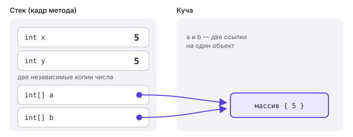

::::warmup

```quiz
id: copy-value
type: output
prompt: Что выведет код? `$"{x} {y}"` подставляет значения через пробел.
code: |
  int x = 1;
  int y = x;
  y = 2;
  Console.WriteLine($"{x} {y}");
answer: 1 2
explain: |
  `int` — значимый тип: `y = x` копирует само число. Дальше `x` и `y` живут независимо.
variants:
  - code: |
      int[] x = { 1 };
      int[] y = x;
      y[0] = 2;
      Console.WriteLine($"{x[0]} {y[0]}");
    answer: 2 2
    explain: |
      Массив — ссылочный тип: `y = x` копирует ссылку. Обе переменные указывают на один массив, поэтому изменение через `y` видно через `x`.
```

::::

::::part Два вида типов

Все типы C# делятся на два вида — по тому, что лежит в переменной.

**Значимые типы** (value types): в переменной лежит **само значение**. Присваивание копирует значение целиком.

**Ссылочные типы** (reference types): в переменной лежит **ссылка** — адрес объекта в куче. Присваивание копирует только ссылку, объект остаётся один.



| Значимые | Ссылочные |
|---|---|
| числа: `int`, `long`, `double`, `decimal` и другие | `string` |
| `bool`, `char` | массивы: `int[]`, `string[]` |
| перечисления (`enum`) | `object` |
| структуры (`struct`): `DateTime`, `TimeSpan`, `Guid` | классы (`class`): `StringBuilder`, `List<T>` и ваши собственные |
| кортежи `(int, string)` | делегаты и записи `record` |

Структуры, классы, перечисления и записи — темы следующих разделов. Пока достаточно запомнить, какие из уже знакомых типов к какому виду относятся.

Из этого различия следуют главные отличия:

- **Копирование.** Значимый — копия данных, ссылочный — копия ссылки.
- **`null`.** Ссылка может никуда не указывать, это `null`. У значимого типа всегда есть значение: `int` не бывает `null` (для этого есть отдельный тип `int?`, о нём — в теме про `null`).
- **Значение по умолчанию.** У значимого — «нули» (`0`, `false`), у ссылочного — `null`.

```quiz
id: copy-reference
type: output
prompt: Что выведет код?
code: |
  var a = new StringBuilder("кот");
  var b = a;
  b.Append("ик");
  Console.WriteLine(a.ToString());
answer: котик
explain: |
  `StringBuilder` — класс, ссылочный тип. `b = a` копирует ссылку, и обе переменные указывают на один объект. `Append` меняет этот объект.
variants:
  - code: |
      var a = new StringBuilder("кот");
      var b = a;
      b = new StringBuilder("пёс");
      Console.WriteLine(a.ToString());
    answer: кот
    explain: |
      `b = new StringBuilder(...)` записывает в `b` ссылку на новый объект. `a` по-прежнему указывает на старый.
```

```quiz
id: which-kind
type: multi
prompt: Какие из этих типов — значимые?
options:
  - "int"
  - "string"
  - "bool"
  - "int[]"
  - "DateTime"
  - "object"
answer: [0, 2, 4]
explain: |
  `int` и `bool` — встроенные значимые типы, `DateTime` — структура. `string`, массивы и `object` — ссылочные. Массив ссылочный, даже если его элементы — `int`.
variants:
  - options:
      - "double"
      - "StringBuilder"
      - "char"
      - "string[]"
      - "Guid"
      - "decimal"
    answer: [0, 2, 4, 5]
    explain: |
      `double`, `char` и `decimal` — встроенные значимые типы, `Guid` — структура. `StringBuilder` — класс, `string[]` — массив, оба ссылочные.
```

::::

::::part Стек и куча

Память программы, о которой здесь идёт речь, — это две области.

**Стек** (stack) — память для вызовов методов. Каждый вызов получает свой **кадр**: в нём параметры и локальные переменные. Когда метод возвращается, кадр снимается целиком. Выделение на стеке почти бесплатное — это сдвиг указателя.

**Куча** (heap) — память для объектов. Объект живёт, пока на него есть ссылки. Освобождает её **сборщик мусора** (GC): время от времени находит объекты, на которые никто не ссылается, и убирает их.

Часто говорят: «значимые типы — в стеке, ссылочные — в куче». Это **неточно**, и на собеседованиях любят это уточнить. Правильно так:

- **Объекты ссылочных типов** всегда в куче. Сама переменная со ссылкой может лежать на стеке.
- **Значимые типы лежат там, где объявлены.** Локальная переменная `int` — в кадре стека. Но элемент массива `int[]` лежит в куче, внутри объекта массива. Поле `int` внутри объекта класса — тоже в куче, вместе с объектом.

```csharp
int count = 3;                // count — в стеке
int[] numbers = { 1, 2, 3 };  // ссылка numbers — в стеке, массив с числами 1, 2, 3 — в куче
```

Есть и менее очевидные случаи, когда локальная переменная переезжает в кучу: её захватила лямбда или она живёт в асинхронном методе. Они разобраны в своих темах.

```quiz
id: where-int-lives
type: choice
prompt: Где лежат числа массива `int[] numbers = { 1, 2, 3 };`, объявленного в методе?
options:
  - "В куче, внутри объекта массива"
  - "В стеке: int — значимый тип"
  - "Ссылка и числа — в стеке"
  - "Каждое число — в отдельном объекте в куче"
answer: 0
explain: |
  Массив — объект в куче, и его элементы лежат внутри него подряд. В стеке только ссылка `numbers`. Значимый тип лежит там, где объявлен, — здесь внутри массива.
```

::::

::::part Передача в метод

Аргумент всегда передаётся **по значению**, если нет `ref` или `out`. Но для ссылочного типа «значение» — это ссылка. Отсюда классический вопрос с собеседований.

```csharp
int[] data = { 1, 2, 3 };

Modify(data);   // data[0] стал 100: метод изменил объект по ссылке
Replace(data);  // data не изменился: метод заменил только свою копию ссылки

void Modify(int[] items) => items[0] = 100;
void Replace(int[] items) => items = new int[] { 7, 8, 9 };
```

- `Modify` получил копию ссылки. Копия указывает на тот же массив, поэтому изменение элемента видно снаружи.
- `Replace` записал в свой параметр ссылку на новый массив. Переменная `data` снаружи об этом не знает: у неё своя копия ссылки, и она указывает на старый массив.

С `ref` метод получает саму переменную, и замена видна:

```csharp
ReplaceRef(ref data);  // теперь data указывает на { 7, 8, 9 }

void ReplaceRef(ref int[] items) => items = new int[] { 7, 8, 9 };
```

Итоговая таблица:

| В методе | Значимый тип | Ссылочный тип |
|---|---|---|
| изменить содержимое объекта | — | видно снаружи |
| присвоить параметру новое значение | не видно снаружи | не видно снаружи |
| то же с `ref` | видно снаружи | видно снаружи |

```quiz
id: param-replace
type: output
prompt: Что выведет код?
code: |
  int[] data = { 1, 2, 3 };
  Replace(data);
  Console.WriteLine(data[0]);

  void Replace(int[] items) => items = new int[] { 9, 9, 9 };
answer: "1"
explain: |
  Метод заменил свою копию ссылки, а `data` снаружи по-прежнему указывает на старый массив.
variants:
  - code: |
      int[] data = { 1, 2, 3 };
      Replace(ref data);
      Console.WriteLine(data[0]);

      void Replace(ref int[] items) => items = new int[] { 9, 9, 9 };
    answer: "9"
    explain: |
      С `ref` метод работает с самой переменной `data`, и новая ссылка записывается в неё.
  - code: |
      int[] data = { 1, 2, 3 };
      Modify(data);
      Console.WriteLine(data[0]);

      void Modify(int[] items) => items[0] = 9;
    answer: "9"
    explain: |
      Копия ссылки указывает на тот же массив. Изменение элемента видно снаружи и без `ref`.
```

```quiz
id: builder-param
type: output
prompt: Что выведет код?
code: |
  var text = new StringBuilder("a");
  Add(text);
  Console.WriteLine(text.ToString());

  void Add(StringBuilder builder)
  {
      builder.Append("b");
      builder = new StringBuilder("x");
      builder.Append("c");
  }
answer: ab
explain: |
  Сначала метод дописал `b` в общий объект. Потом записал в параметр ссылку на новый объект, и `c` попало уже в него. `text` снаружи указывает на первый объект: `ab`.
```

::::

::::part Сравнение: значения и ссылки

`==` ведёт себя по-разному:

- **Значимые типы** сравниваются по значению: `5 == 5` — `true`.
- **Ссылочные типы** по умолчанию сравниваются по **ссылке**: равны, только если указывают на один объект.

```csharp
int[] a = { 1, 2 };
int[] b = { 1, 2 };
int[] c = a;

Console.WriteLine(a == b);  // False: два разных объекта
Console.WriteLine(a == c);  // True: один объект
```

Исключения — типы, у которых сравнение переопределено: `string` сравнивает текст, записи `record` — значения полей (о них — отдельная тема). Чтобы сравнить именно ссылки у любого типа, есть `ReferenceEquals(a, b)`.

```quiz
id: arrays-compare
type: output
prompt: Что выведет код?
code: |
  int[] a = { 1, 2 };
  int[] b = { 1, 2 };
  Console.WriteLine(a == b);
answer: "False"
explain: |
  `==` для массивов сравнивает ссылки, а `a` и `b` — два разных объекта, хоть и с одинаковым содержимым.
variants:
  - code: |
      int[] a = { 1, 2 };
      int[] b = a;
      Console.WriteLine(a == b);
    answer: "True"
    explain: |
      `b = a` копирует ссылку: обе переменные указывают на один массив.
  - code: |
      string a = "ab";
      string b = "a" + "b".ToString();
      Console.WriteLine(a == b);
    answer: "True"
    explain: |
      Для строк `==` переопределён и сравнивает текст, а он одинаковый.
```

:::level middle

**Что лежит в объекте.** Каждый объект в куче начинается со служебной части: заголовок (8 байт на 64-битной платформе: используется для `lock`, хеш-кода) и указатель на таблицу методов типа (8 байт). Минимальный объект занимает 24 байта. Ссылка — 8 байт.

**Копирование больших значимых типов.** Значимый тип копируется целиком при каждом присваивании и передаче в метод. Для `int` это 4 байта, а структура из десяти `decimal` — уже 160. Поэтому большие структуры передают по ссылке (`in`, `ref`) или делают классами. Подробнее — в теме про структуры.

**Почему не всё ссылочное.** Значимые типы не нагружают сборщик мусора, лежат компактно (массив из миллиона `int` — один блок по 4 МБ) и не требуют разыменования ссылки при доступе. Поэтому числа, даты, координаты — значимые.

```quiz
id: min-object
type: choice
level: middle
prompt: Сколько памяти минимум занимает объект ссылочного типа на 64-битной платформе?
options:
  - "24 байта"
  - "8 байт"
  - "4 байта"
  - "1 байт"
answer: 0
explain: |
  Заголовок (8) и указатель на таблицу методов (8) есть у каждого объекта, плюс минимум 8 байт на данные с учётом выравнивания. Сама ссылка на объект — 8 байт.
```

:::

::::

::::practice

```quiz
id: doubled-task
type: code
lang: csharp
prompt: |
  Допишите метод: он возвращает **новый** массив, где каждый элемент удвоен. Исходный массив меняться не должен.
starter: |
  public static class Arrays
  {
      public static int[] Doubled(int[] source)
      {
      }
  }
tests: |
  var source = new[] { 1, 2, 3 };
  var result = Arrays.Doubled(source);
  Assert.Equal(2, result[0]);
  Assert.Equal(6, result[2]);
  Assert.Equal(1, source[0]);
  Assert.True(result != source);
solution: |
  public static class Arrays
  {
      public static int[] Doubled(int[] source)
      {
          var result = new int[source.Length];
          for (int i = 0; i < source.Length; i++)
              result[i] = source[i] * 2;
          return result;
      }
  }
explain: |
  Параметр — копия ссылки на тот же массив, поэтому изменять его нельзя: изменения увидит вызывающий код. Нужен новый массив той же длины.
variants:
  - prompt: |
      Допишите метод: он меняет местами первый и последний элементы массива **на месте**. Метод ничего не возвращает, но вызывающий код должен увидеть изменение. Массив непустой.
    starter: |
      public static class Arrays
      {
          public static void SwapEnds(int[] items)
          {
          }
      }
    tests: |
      var a = new[] { 1, 2, 3 };
      Arrays.SwapEnds(a);
      Assert.Equal(3, a[0]);
      Assert.Equal(1, a[2]);
      var b = new[] { 7 };
      Arrays.SwapEnds(b);
      Assert.Equal(7, b[0]);
    solution: |
      public static class Arrays
      {
          public static void SwapEnds(int[] items)
          {
              int last = items.Length - 1;
              int temp = items[0];
              items[0] = items[last];
              items[last] = temp;
          }
      }
    explain: |
      `ref` не нужен: метод меняет элементы объекта, а не саму ссылку. Копия ссылки указывает на тот же массив.
```

::::

::::traps

- **«Значимые — в стеке» — неточно.** Значимые лежат там, где объявлены: элемент массива и поле объекта — в куче.
- **Присваивание ссылочного типа не копирует объект.**
- **Без `ref` метод может изменить объект, но не может заменить переменную вызывающего.**
- **`==` у ссылочных типов по умолчанию сравнивает ссылки.** Исключения — `string` и записи.
- **Массив `int[]` — ссылочный тип**, хотя его элементы значимые.
- **`int` не бывает `null`.** `null` — только у ссылочных типов и у `int?`.

::::

::::summary

```quiz
id: value-reference-recall
type: recall
prompt: Чем значимые типы отличаются от ссылочных? Где они хранятся и что происходит при передаче в метод?
answer: |
  В переменной **значимого** типа лежит само значение, присваивание и передача копируют его целиком. Это числа, `bool`, `char`, перечисления, структуры. В переменной **ссылочного** типа лежит ссылка на объект в куче, копируется только ссылка. Это `string`, массивы, `object`, классы, делегаты.
  Объекты ссылочных типов всегда в куче, их убирает сборщик мусора. Значимые лежат там, где объявлены: локальная переменная — в стеке, элемент массива или поле объекта — в куче. «Значимые всегда в стеке» — миф.
  Без `ref` метод получает копию ссылки: может изменить объект, но замена параметра снаружи не видна. С `ref` метод работает с самой переменной.
  `==` у значимых сравнивает значения, у ссылочных по умолчанию — ссылки; `string` и записи переопределяют сравнение. У ссылочного типа бывает `null`, у значимого — нет.
```

::::

::::test

```quiz
id: test-kind-string
type: choice
part: "Два вида типов"
prompt: К какому виду относится `string`?
options:
  - "Ссылочный тип, но неизменяемый и с == по содержимому"
  - "Значимый тип"
  - "Значимый, если строка короче 16 символов"
  - "Ни к какому: это особый встроенный тип"
answer: 0
explain: |
  Строка — объект в куче, переменная хранит ссылку. Ведёт себя «как значение» благодаря неизменяемости и переопределённому `==`.
```

```quiz
id: test-default-ref
type: choice
part: "Два вида типов"
prompt: Какое значение по умолчанию у переменной ссылочного типа, например поля типа `int[]`?
options:
  - "null"
  - "Пустой массив"
  - "0"
  - "Значения по умолчанию нет"
answer: 0
explain: |
  Значение по умолчанию у любого ссылочного типа — `null`: ссылка, которая никуда не указывает.
```

```quiz
id: test-copy-builder
type: output
part: "Два вида типов"
prompt: Что выведет код?
code: |
  var first = new StringBuilder("1");
  var second = first;
  second.Append("2");
  first.Append("3");
  Console.WriteLine(second.ToString());
answer: "123"
explain: |
  `first` и `second` указывают на один объект. Оба `Append` дописывают в него.
```

```quiz
id: test-stack-frame
type: choice
part: "Стек и куча"
prompt: Что происходит с локальными переменными метода, когда он завершается?
options:
  - "Кадр стека снимается вместе с ними"
  - "Их убирает сборщик мусора при следующей сборке"
  - "Они остаются до конца программы"
  - "Они переносятся в кучу"
answer: 0
explain: |
  Кадр стека освобождается сразу при возврате из метода. Объекты в куче, на которые ссылались переменные, уберёт сборщик мусора, если на них больше никто не ссылается.
```

```quiz
id: test-heap-who
type: choice
part: "Стек и куча"
prompt: Кто освобождает память объектов в куче?
options:
  - "Сборщик мусора, когда на объект не остаётся ссылок"
  - "Программист, вызывая delete"
  - "Объект освобождается при выходе из метода, где создан"
  - "Память кучи не освобождается"
answer: 0
explain: |
  В .NET память управляемая: объекты без ссылок находит и убирает сборщик мусора. Ручного `delete` нет.
```

```quiz
id: test-myth
type: choice
part: "Стек и куча"
prompt: Верно ли утверждение «значимые типы всегда хранятся в стеке»?
options:
  - "Нет: элемент массива или поле объекта значимого типа лежит в куче"
  - "Да, всегда"
  - "Да, кроме string"
  - "Нет: значимые всегда в куче"
answer: 0
explain: |
  Значимый тип лежит там, где объявлен. Локальная переменная — в стеке, а `int` внутри массива или объекта — в куче.
```

```quiz
id: test-modify-elements
type: output
part: "Передача в метод"
prompt: Что выведет код?
code: |
  int[] data = { 5, 5 };
  Clear(data);
  Console.WriteLine(data[1]);

  void Clear(int[] items)
  {
      for (int i = 0; i < items.Length; i++)
          items[i] = 0;
  }
answer: "0"
explain: |
  Метод изменил элементы того же массива, на который указывает `data`. `ref` для этого не нужен.
```

```quiz
id: test-int-param
type: output
part: "Передача в метод"
prompt: Что выведет код?
code: |
  int count = 1;
  Increase(count);
  Console.WriteLine(count);

  void Increase(int value) => value += 10;
answer: "1"
explain: |
  `int` передаётся копией значения. Метод увеличил свою копию.
variants:
  - code: |
      int count = 1;
      Increase(ref count);
      Console.WriteLine(count);

      void Increase(ref int value) => value += 10;
    answer: "11"
    explain: |
      С `ref` метод работает с самой переменной `count`.
```

```quiz
id: test-ref-needed
type: choice
part: "Передача в метод"
prompt: Метод должен заменить массив вызывающего кода на новый, больший. Как его объявить?
options:
  - "void Grow(ref int[] items)"
  - "void Grow(int[] items)"
  - "void Grow(in int[] items)"
  - "Так нельзя сделать ни одним способом"
answer: 0
explain: |
  Без `ref` метод заменит только свою копию ссылки. `in` запрещает присваивать параметру. Так устроен `Array.Resize(ref array, size)`.
```

```quiz
id: test-reference-equals
type: output
part: "Сравнение: значения и ссылки"
prompt: Что выведет код?
code: |
  var a = new StringBuilder("x");
  var b = new StringBuilder("x");
  Console.WriteLine(a == b);
answer: "False"
explain: |
  `StringBuilder` не переопределяет `==`, поэтому сравниваются ссылки. Объекты разные.
```

```quiz
id: test-value-equals
type: output
part: "Сравнение: значения и ссылки"
prompt: Что выведет код?
code: |
  int a = 7;
  int b = 7;
  Console.WriteLine(a == b);
answer: "True"
explain: |
  Значимые типы сравниваются по значению.
```

```quiz
id: test-copy-cost
type: choice
part: "Сравнение: значения и ссылки"
level: middle
prompt: Почему большую структуру передают в метод через `in`?
options:
  - "Чтобы не копировать её целиком при каждом вызове"
  - "Чтобы метод мог её изменить"
  - "Без in структуру нельзя передать"
  - "in размещает структуру в куче"
answer: 0
explain: |
  Значимый тип копируется целиком. `in` передаёт ссылку только для чтения: копии нет, менять нельзя.
```

::::
